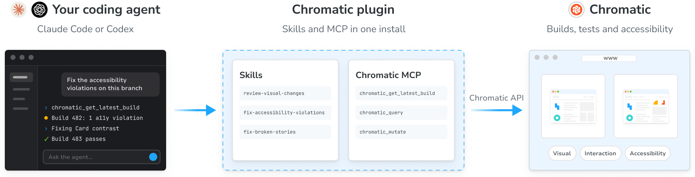
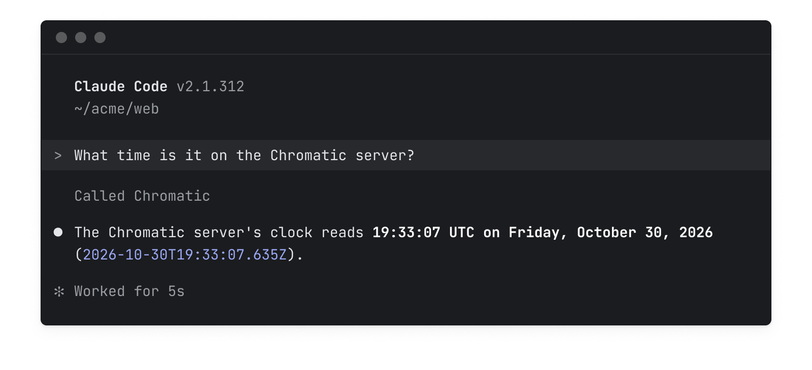

import { BetaBadge } from '../../components/BetaBadge';
import { TabItem, Tabs } from '../../components/Tabs';

# Chromatic for agents<BetaBadge />

Chromatic for agents lets your coding agent read every Chromatic build and act on what it finds. It fixes broken stories and accessibility violations in your code, points out the visual changes that need a person to review, and tells you whether your branch is ready to merge.

It's made up of:

- **[Chromatic MCP server](/docs/mcp)** lets your agent interact with Chromatic as you.
- **[Skills](/docs/skills)** teach your agent workflows such as fixing accessibility violations or reviewing visual changes.
- **[Plugins](#1-install-the-chromatic-plugin-for-your-agent)** for Claude Code and Codex bundle the MCP server and skills into a single package.
- **[Chromatic API](/docs/api)** enables you to build custom agent workflows and pull data into internal dashboards.



## Get started

The plugin is the recommended way to start since it bundles the MCP server and skills into a single package. In Claude Code it also adds hooks that check your build after you push.

### 1. Install the Chromatic plugin for your agent

<Tabs>
  <TabItem label="Claude Code">
    ```shell
    claude plugin marketplace add chromaui/chromatic-plugins
    claude plugin install chromatic@chromatic
    ```

    Then start a session, run `/mcp`, choose **chromatic**, and approve the request in your browser. In the Claude Code desktop app, send any first message, such as "hi", before you run `/mcp`.

    `claude mcp list` should show `plugin:chromatic:chromatic`.

  </TabItem>
  <TabItem label="Codex">
    ```shell
    codex plugin marketplace add chromaui/chromatic-plugins
    codex plugin add chromatic@chromatic
    codex mcp login chromatic
    ```

    <div class="aside" style="margin-bottom: 1em;">

    Requires the Codex CLI version 0.148 or newer. Check with `codex --version`.

    </div>

    Approve the request in your browser. `codex mcp list` should show OAuth in the Auth column.

    In the ChatGPT app, quit and reopen it, then pick **Codex** in the sidebar. **Plugins** lists Chromatic under **Personal**. Sign in with a ChatGPT account, not an API key, or **Plugins** stays locked.

  </TabItem>
  <TabItem label="Other tools (manual install)">
    ```shell
    # Choose skills from a list
    npx skills add chromaui/chromatic-plugins

    # Add one skill
    npx skills add chromaui/chromatic-plugins --skill fix-accessibility-violations

    # Update the skills you installed
    npx skills update
    ```

    <div class="aside" style="margin-bottom: 1em;">
      Add `--global` to install the skills for every project rather than the current one. If your agent has no skills support, skip this step. It can still use the tools.
    </div>

    **Install the MCP server:** In your agent's MCP settings, add a remote server with the URL `https://mcp.chromatic.com/mcp` (Streamable HTTP). Leave any OAuth client ID and secret empty.

    Your agent identifies itself with a client metadata document (CIMD) when it logs in, and your browser opens chromatic.com for you to approve the request. Any agent that supports remote MCP servers over Streamable HTTP and logs in with CIMD can connect.

    If you run into issues, check the [Add the MCP server by hand](/docs/mcp#add-the-mcp-server-by-hand) section.

  </TabItem>
</Tabs>

### 2. Verify the connection

Ask your agent: “What time is it on the Chromatic server?” If it answers with a time, you are connected and logged in.



### 3. Connect your project

Your agent needs to know which Chromatic project your repository belongs to. It reads the `projectId` from [`chromatic.config.json`](/docs/cli#chromatic-config-file) at the root of your repository. Ask your agent to connect your Chromatic project, and the `connect-project` skill finds the project from your Git remote and writes the file for you.

<div class="callout">
  ℹ️ The project ID is not your project token, and your agent never asks for the token. See
  [**Chromatic MCP » Project ID**](/docs/mcp#project-id) for more info.
</div>

### 4. Try out a workflow

Here are a few sample prompts you can ask your agent:

**"What's the latest Chromatic build on this branch?"**<br />
Your agent reports the build's status, how many tests changed or broke, what to do next, and a link to the build.

**"Fix the accessibility violations Chromatic found on this branch."**<br />
It lists the stories whose violations got worse, fixes them in your component source, and checks the fix on the next build.

**"Which visual changes on this build look unintended?"**<br />
It compares each changed snapshot with your code change, and sorts the changes into the ones your code explains and the ones worth a closer look.

**"Is this branch ready to merge as far as Chromatic is concerned?"**<br />
It checks the latest build against your current commit and lists what is left: broken tests, changes waiting for review, open comments, and new accessibility violations.


---

## Frequently asked questions

<details id="update-the-plugin">

<summary>How do I update the plugin?</summary>

Refresh the marketplace, update the plugin, then restart your session.

<Tabs>
  <TabItem label="Claude Code">

    ```shell
    claude plugin marketplace update chromatic
    claude plugin update chromatic@chromatic
    ```

  </TabItem>
  <TabItem label="Codex">

    ```shell
    codex plugin marketplace upgrade chromatic
    codex plugin remove chromatic@chromatic
    codex plugin add chromatic@chromatic
    ```

  </TabItem>
</Tabs>

To check your version in Claude Code, run `claude plugin list` and look for `chromatic@chromatic`.

</details>

<details id="remove-the-plugin">

<summary>How do I remove the plugin?</summary>

<Tabs>
  <TabItem label="Claude Code">

    ```shell
    claude plugin uninstall chromatic@chromatic
    claude plugin marketplace remove chromatic
    ```

  </TabItem>
  <TabItem label="Codex">

    ```shell
    codex plugin remove chromatic@chromatic
    codex plugin marketplace remove chromatic
    ```

  </TabItem>
</Tabs>

</details>

<details id="chromatic-listed-twice">

<summary>Why does Chromatic show up twice in my MCP list?</summary>

You have it as a connector or a server you added by hand, and as a plugin. This is harmless. To keep only the plugin's server, run `claude mcp remove chromatic` or `codex mcp remove chromatic`, or remove the connector.

</details>
