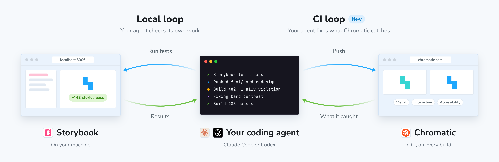
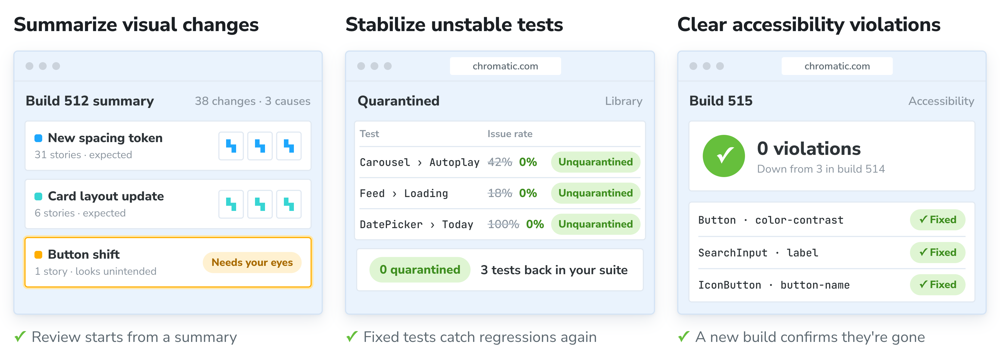

import { TabItem, Tabs } from '../../components/Tabs';

# Chromatic for agents

Your coding agent can read every Chromatic build and fix what it finds. Ask it whether your branch is ready to merge, and it checks the build, fixes broken stories and accessibility violations in your code, and walks you through the visual changes that need a person to look at them.

Chromatic for agents is made of:

- **[Chromatic API](/docs/api)** gives you your builds, tests, accessibility results, and published Storybooks as GraphQL.
- **[Chromatic MCP server](/docs/mcp)** lets your agent call that API as you, after one login in your browser.
- **[Skills](/docs/skills)** teach your agent workflows that chain those calls with your code, such as fixing accessibility violations or reviewing visual changes.
- **[Plugins](#quickstart-with-the-plugin)** for Claude Code and Codex bundle the server connection, the login, and every skill.



## Quickstart with the plugin

The plugin is the recommended way to start. One install gives you the server connection, the login, and every [skill](/docs/skills). In Claude Code it also adds hooks that check your build after you push.

Before you start, you need:

- A Chromatic account with a project that has builds.
- Claude Code, or the Codex CLI version 0.148 or newer (check with `codex --version`).
- For accessibility work, [accessibility tests](/docs/accessibility) turned on for your project. Builds from before you turn them on have no accessibility data.

<Tabs>
  <TabItem label="Claude Code">
    ```shell
    claude plugin marketplace add chromaui/chromatic-plugins
    claude plugin install chromatic@chromatic
    ```

    Then start a session, run `/mcp`, choose **chromatic**, and approve the request in your browser. In the Claude Code desktop app, send any first message, such as "hi", before you run `/mcp`.

    `claude mcp list` should show `plugin:chromatic:chromatic`.

  </TabItem>
  <TabItem label="Codex and the ChatGPT app">
    ```shell
    codex plugin marketplace add chromaui/chromatic-plugins
    codex plugin add chromatic@chromatic
    codex mcp login chromatic
    ```

    Approve the request in your browser. `codex mcp list` should show OAuth in the Auth column.

    In the ChatGPT app, quit and reopen it, then pick **Codex** in the sidebar. **Plugins** lists Chromatic under **Personal**. Sign in with a ChatGPT account, not an API key, or **Plugins** stays locked.

  </TabItem>
</Tabs>

To check it worked, ask your agent: "What time is it on the Chromatic server?" If it answers with a time, you are connected and logged in.

<details id="other-agents">

<summary>Not using Claude Code or Codex?</summary>

Connect the server and add the skills yourself.

1. **Add the MCP server.** In your agent's MCP settings, add a remote server with the URL `https://mcp.chromatic.com/mcp` (Streamable HTTP). Leave any OAuth client ID and secret empty. The server registers your agent itself when it logs in, and your browser opens chromatic.com for you to approve the request. Any agent that supports remote MCP servers over Streamable HTTP with an OAuth login can connect. For Claude Desktop, claude.ai, and the ChatGPT app, see [Add the MCP server by hand](/docs/mcp#add-the-mcp-server-by-hand). For the clients Chromatic has tested, see [Which clients are supported?](/docs/mcp#which-clients-are-supported). Cursor cannot log in yet.

2. **Install the skills.** Use the [skills CLI](https://skills.sh), which puts the skills where each of your agents looks for them:

   ```shell
   # Choose skills from a list
   npx skills add chromaui/chromatic-plugins

   # Add one skill
   npx skills add chromaui/chromatic-plugins --skill fix-accessibility-violations

   # Update the skills you installed
   npx skills update
   ```

   Add `--global` to install the skills for every project rather than the current one. If your agent has no skills support, skip this step. It can still use the tools.

To check it worked, ask your agent: "What time is it on the Chromatic server?" If it answers with a time, you are connected and logged in.

<div class="aside">
  **A skill is instructions, not a connection.** Without the server connected, a skill has nothing
  to call, so don't skip step 1.
</div>

</details>

## Connect your project

Your agent needs to know which Chromatic project your repository belongs to. It reads the `projectId` from `chromatic.config.json` at the root of your repository. Ask your agent to connect your Chromatic project, and the `connect-project` skill finds the project from your Git remote and writes the file for you. The project ID is not your project token, and your agent never asks for the token. See [Project ID](/docs/mcp#project-id).

## What your agent can do

Ask in plain words. You never need to name a tool or a skill.

- **"What's the latest Chromatic build on this branch?"** Your agent reports the build's status, how many tests changed or broke, what to do next, and a link to the build.
- **"Fix the accessibility violations Chromatic found on this branch."** It lists the stories whose violations got worse, fixes them in your component source, and checks the fix on the next build.
- **"Which visual changes on this build look unintended?"** It compares each changed snapshot with your code change, and sorts the changes into the ones your code explains and the ones worth a closer look.
- **"Is this branch ready to merge as far as Chromatic is concerned?"** It checks the latest build against your current commit and lists what is left: broken tests, changes waiting for review, open comments, and new accessibility violations.



Each of these is a skill. See [Skills](/docs/skills) for how they work and how to run one by name.

## Go deeper

Once your agent is connected, go further:

- [**Connect another agent by hand:**](/docs/mcp#add-the-mcp-server-by-hand) Add the Chromatic MCP server to Claude Desktop, claude.ai, the ChatGPT app, or any agent that supports remote MCP servers.
- [**Run skills without the plugin:**](/docs/skills#get-the-skills) Install the skills with the skills CLI and run any of them by name.
- [**Share your components with agents:**](/docs/storybook-mcp) Publish your Storybook's MCP server so agents build UI with the components and docs you already have.
- [**Build your own workflows:**](/docs/api) Query builds, tests, and accessibility results from your own scripts, bots, and dashboards with the Chromatic API.
- [**Automate with a service client:**](/docs/oauth-clients) Create an OAuth client so CI pipelines and bots can call the API without a signed-in user.

## Frequently asked questions

<details id="update-the-plugin">

<summary>How do I update the plugin?</summary>

Refresh the marketplace, update the plugin, then restart your session.

<Tabs>
  <TabItem label="Claude Code">

    ```shell
    claude plugin marketplace update chromatic
    claude plugin update chromatic@chromatic
    ```

  </TabItem>
  <TabItem label="Codex">

    ```shell
    codex plugin marketplace upgrade chromatic
    codex plugin remove chromatic@chromatic
    codex plugin add chromatic@chromatic
    ```

  </TabItem>
</Tabs>

To check your version in Claude Code, run `claude plugin list` and look for `chromatic@chromatic`.

</details>

<details id="remove-the-plugin">

<summary>How do I remove the plugin?</summary>

<Tabs>
  <TabItem label="Claude Code">

    ```shell
    claude plugin uninstall chromatic@chromatic
    claude plugin marketplace remove chromatic
    ```

  </TabItem>
  <TabItem label="Codex">

    ```shell
    codex plugin remove chromatic@chromatic
    codex plugin marketplace remove chromatic
    ```

  </TabItem>
</Tabs>

</details>

<details id="chromatic-listed-twice">

<summary>Why does Chromatic show up twice in my MCP list?</summary>

You have it as a connector or a server you added by hand, and as a plugin. This is harmless. To keep only the plugin's, run `claude mcp remove chromatic` or `codex mcp remove chromatic`, or remove the connector.

</details>
