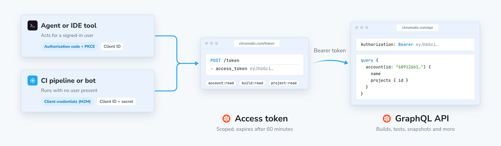

# Chromatic API

Chromatic's public API is built using GraphQL. If you are new to GraphQL, Apollo has [resources for beginners](https://blog.apollographql.com/the-basics-of-graphql-in-5-links-9e1dc4cac055). The official [GraphQL documentation](https://graphql.org/) is another good starting point.

<details>
  <summary>Prompt for AI-assisted set up</summary>

Follow this doc to authenticate with OAuth 2.0 in order to access the Chromatic API: https://www.chromatic.com/docs/llms/api.txt

If you have a client secret, authenticate with the client credentials grant. Otherwise, use the authorization code flow with PKCE.

The client ID is: <REPLACE_WITH_CLIENT_ID_FROM_YOUR_OAUTH_CLIENT>
The client secret is: <REPLACE_WITH_CLIENT_SECRET_FROM_YOUR_OAUTH_CLIENT_OR_DELETE_THIS_LINE>
The account ID is: <REPLACE_WITH_ACCOUNT_ID_OR_DELETE_THIS_LINE>

If you authenticated without a client secret, use the `viewer` query via `accounts { projects }`. If you have a client secret, use the `account` query with the account ID above.

</details>

## Endpoint

Chromatic's GraphQL endpoint is:

```bash
https://www.chromatic.com/api
```

It supports introspection, so you can query the whole schema.

Introspection returns every field, but your token can only reach the fields its scopes allow. The [scopes reference](#scopes-reference) lists what each scope unlocks.

## Getting started

To get a client ID, [create an OAuth client](/docs/oauth-clients): a user client for the authorization code flow with PKCE, or a service client for the client credentials (M2M) flow. With your client ID, go through the authorization flow (outlined below) to receive an `access_token`.

Once you have it, our GraphQL API is explorable and queryable via [Apollo Studio](https://www.chromatic.com/api): a GraphQL client where you can browse the schema and run queries.

Add the `Authorization` header with the value `Bearer <access_token>` to authenticate your requests.

### Authentication

Chromatic supports two OAuth 2.0 flows to issue access tokens. All API requests must include a valid access token in the `Authorization` header.

| Flow                                                          | Use when                                                                                       | Credentials                 |
| ------------------------------------------------------------- | ---------------------------------------------------------------------------------------------- | --------------------------- |
| [Authorization code with PKCE](#authorization-code-with-pkce) | An agent or tool acts on behalf of a signed-in user, such as local development or an IDE agent | Client ID                   |
| [Client credentials (M2M)](#client-credentials-m2m)           | Headless automation runs with no user present, such as a CI pipeline, bot, or service          | Client ID and client secret |



#### Authorization code with PKCE

Use your client ID with the Chromatic OAuth client to run the authorization code flow. This opens a browser window for you to approve access, then exchanges the resulting code for a token pair.

**Authorization endpoint**: `https://www.chromatic.com/authorize`

| Parameter               | Value                                                                                                   |
| ----------------------- | ------------------------------------------------------------------------------------------------------- |
| `response_type`         | `code`                                                                                                  |
| `client_id`             | `<your_client_id>`                                                                                      |
| `redirect_uri`          | Your local callback (e.g. `http://localhost:8080/callback`)                                             |
| `scope`                 | `user:read account:read account:write project:read project:write build:read build:write storybook:read` |
| `resource`              | `https://www.chromatic.com/api` (required)                                                              |
| `code_challenge_method` | `S256`                                                                                                  |

Chromatic will redirect to your `redirect_uri` with `?code=<AUTH_CODE>&state=<STATE>`.

**Token endpoint**: `https://www.chromatic.com/token`

| Parameter       | Value                                        |
| --------------- | -------------------------------------------- |
| `grant_type`    | `authorization_code`                         |
| `client_id`     | `<your_client_id>`                           |
| `code`          | The authorization code from the redirect     |
| `redirect_uri`  | Same value used in the authorization request |
| `code_verifier` | Your PKCE verifier                           |
| `resource`      | `https://www.chromatic.com/api` (required)   |

Include the access token in the `Authorization` header of every API request:

```javascript
Authorization: Bearer <your_access_token>
```

<div class="aside">

💡 Access tokens expire after **60 minutes**. Use the `refresh_token` grant to get a new one without re-authorizing.

</div>

---

#### Refreshing your token

This applies only to the authorization code flow; the client credentials grant doesn't issue refresh tokens. Access tokens are short-lived. Use your `refresh_token` to obtain a new token pair without re-authorizing. Refresh tokens **rotate on every use**. Always save the new `refresh_token` from the response.

```bash
curl -s -X POST https://www.chromatic.com/token \
  -H "Content-Type: application/x-www-form-urlencoded" \
  --data-urlencode "grant_type=refresh_token" \
  --data-urlencode "client_id=<your_client_id>" \
  --data-urlencode "refresh_token=<your_refresh_token>" \
  --data-urlencode "resource=https://www.chromatic.com/api"
```

---

#### Client credentials (M2M)

Machine-to-machine (M2M) clients authenticate directly with a client ID and client secret. There's no browser redirect and no user approval step, which makes this the right flow for CI pipelines, bots, and other headless automation. To create one, follow [Create a service client](/docs/oauth-clients#create-a-service-client).

**Token endpoint**: `https://www.chromatic.com/token`

| Parameter       | Value                                      |
| --------------- | ------------------------------------------ |
| `grant_type`    | `client_credentials` (required)            |
| `client_id`     | `<your_client_id>` (required)              |
| `client_secret` | `<your_client_secret>` (required)          |
| `resource`      | `https://www.chromatic.com/api` (required) |

```bash
curl -s -X POST https://www.chromatic.com/token \
  -H "Content-Type: application/x-www-form-urlencoded" \
  --data-urlencode "grant_type=client_credentials" \
  --data-urlencode "client_id=<your_client_id>" \
  --data-urlencode "client_secret=<your_client_secret>" \
  --data-urlencode "resource=https://www.chromatic.com/api"
```

The response contains an `access_token` that you pass in the `Authorization` header, exactly as with the PKCE flow.

<div class="aside">

💡 Access tokens expire after **60 minutes**. M2M clients don't receive a refresh token; they request a new access token with the same grant when the current one expires.

</div>

Treat the client secret like a password. Store it in your CI provider's secret manager and never commit it. Chromatic shows it once, when you create the client, and can't retrieve it afterward.

M2M tokens act on behalf of an account, not a user, so the `viewer` query and the `user:read` scope aren't available. Use the [`account`](#account) query as your entry point instead.

---

### Making requests

All requests are `POST` to `https://www.chromatic.com/api` with a JSON body containing your `query` and optionally `variables`.

This example queries `viewer`, which requires the `user:read` scope and is available only via the [authorization code with PKCE](#authorization-code-with-pkce) flow. With an M2M token, query [`account`](#account) instead.

```bash
curl -s -X POST https://www.chromatic.com/api \
  -H "Content-Type: application/json" \
  -H "Authorization: Bearer <your_access_token>" \
  -d '{
    "query": "{ viewer { id name username } }"
  }'
```

A successful response looks like this:

```json
{
  "data": {
    "viewer": {
      "id": "User:5f3e7b2a1c9d4e0001a2b3c4",
      "name": "Jane Smith",
      "username": "janesmith"
    }
  }
}
```

#### Errors

A request that fails parsing or validation returns HTTP `400` with a `GRAPHQL_VALIDATION_FAILED` error. An error during execution returns HTTP `200`. Check the `errors` array in every response, whatever the status code:

```json
{
  "errors": [
    {
      "message": "Not authorized",
      "locations": [{ "line": 1, "column": 3 }],
      "path": ["viewer"]
    }
  ],
  "data": null
}
```

Common error causes:

- **Expired token:** access tokens last 60 minutes; refresh and retry
- **Insufficient scope:** the token doesn't include the scope required for that field
- **Not found:** the requested ID doesn't exist or isn't accessible to the authenticated user
- **Rate limited:** HTTP `429` with code `RATE_LIMITED`; wait for the time in `Retry-After`, then retry (see [Rate limits](#rate-limits))

---

### Queries

#### viewer

Returns the authenticated user's profile. Requires the `user:read` scope, which is available via the [authorization code with PKCE](#authorization-code-with-pkce) flow only.

```bash
curl -s -X POST https://www.chromatic.com/api \
  -H "Content-Type: application/json" \
  -H "Authorization: Bearer <your_access_token>" \
  -d '{
    "query": "{ viewer { id name projectCount accounts { id name } } }"
  }'
```

```json
{
  "data": {
    "viewer": {
      "id": "User:5f3e7b2a1c9d4e0001a2b3c4",
      "name": "Jane Smith",
      "projectCount": 8,
      "accounts": [
        {
          "id": "Account:689126b1bf7b127209b4c5b1",
          "name": "Acme Org"
        }
      ]
    }
  }
}
```

---

#### account

Returns an account by ID, either a personal account or an organization account. Requires the `account:read` scope.

**Arguments:**

| Argument | Type | Description        |
| -------- | ---- | ------------------ |
| `id`     | ID!  | Account identifier |

Both the bare ID and the prefixed `Account:` form (as returned in API responses) are accepted.

```bash
curl -s -X POST https://www.chromatic.com/api \
  -H "Content-Type: application/json" \
  -H "Authorization: Bearer <your_access_token>" \
  -d '{
    "query": "query($id: ID!) { account(id: $id) { id name webUrl projects { id }} }",
    "variables": { "id": "<account_id>" }
  }'
```

```json
{
  "data": {
    "account": {
      "id": "689126b1bf7b127209b4c5b1",
      "name": "Acme Org",
      "webUrl": "https://www.chromatic.com/apps?accountId=689126b1bf7b127209b4c5b1",
      "projects": [
        {
          "id": "Project:689126d2bf7b127209b4c5b2"
        }
      ]
    }
  }
}
```

---

#### project

Returns a project by ID. Requires the `project:read` scope.

**Arguments:**

| Argument | Type | Description        |
| -------- | ---- | ------------------ |
| `id`     | ID!  | Project identifier |

```bash
curl -s -X POST https://www.chromatic.com/api \
  -H "Content-Type: application/json" \
  -H "Authorization: Bearer <your_access_token>" \
  -d '{
    "query": "query($id: ID!) { project(id: $id) { id name webUrl branchNames lastBuild { id number status branch } } }",
    "variables": { "id": "<project_id>" }
  }'
```

```json
{
  "data": {
    "project": {
      "id": "Project:689126d2bf7b127209b4c5b2",
      "name": "Marketing Site",
      "webUrl": "https://www.chromatic.com/builds?appId=689126d2bf7b127209b4c5b2",
      "branchNames": ["main", "feat/new-button"],
      "lastBuild": {
        "id": "Build:6891293bbf7b127209b4c6e8",
        "number": 42,
        "status": "PASSED",
        "branch": "main"
      }
    }
  }
}
```

---

#### build

Returns a build by ID. Requires the `build:read` scope.

**Arguments:**

| Argument | Type | Description      |
| -------- | ---- | ---------------- |
| `id`     | ID!  | Build identifier |

Builds progress through several stages (`AnnouncedBuild`, `PublishedBuild`, `PreparedBuild`, `StartedBuild`, and `CompletedBuild`) and expose different fields at each stage. Use inline fragments to handle this:

```bash
curl -s -X POST https://www.chromatic.com/api \
  -H "Content-Type: application/json" \
  -H "Authorization: Bearer <your_access_token>" \
  -d '{
    "query": "query($id: ID!) { build(id: $id) { id number status branch commit ... on CompletedBuild { result testCount componentCount storybookUrl tests { nodes { id } } } } }",
    "variables": { "id": "<build_id>" }
  }'
```

```json
{
  "data": {
    "build": {
      "id": "Build:6891293bbf7b127209b4c6e8",
      "number": 42,
      "status": "PASSED",
      "branch": "main",
      "commit": "a1b2c3d4e5f6",
      "result": "SUCCESS",
      "testCount": 128,
      "componentCount": 24,
      "storybookUrl": "https://689126d2bf7b127209b4c5b2-afxirxnxyz.chromatic.com/",
      "tests": {
        "nodes": [
          {
            "id": "Test:6891294cbf7b127209b4c6f6"
          },
          {
            "id": "Test:6891294cbf7b127209b4c6fe"
          }
        ]
      }
    }
  }
}
```

##### Test-level data

Each test in a build has one visual comparison per tested browser and one accessibility comparison, because [accessibility tests](/docs/accessibility) run only in Chrome. A test captured in Chrome and Firefox has two `visualComparisons` entries and one `accessibilityComparisons` entry. Select `visualComparisons` for the visual result and diff image, and `accessibilityComparisons` for the accessibility rules whose violations changed. `tests` is a paginated connection, so pass `first` and read `pageInfo` to fetch the next page (see [Limits](#limits)).

```graphql
query ($id: ID!) {
  build(id: $id) {
    ... on CompletedBuild {
      tests(first: 50) {
        pageInfo {
          hasNextPage
          endCursor
        }
        nodes {
          id
          status
          result
          isUnstable
          ignoreReason
          visualComparisons {
            result
            platform {
              name
            }
            viewport {
              width
            }
            diff {
              result
              diffImage {
                imageUrl
              }
            }
          }
          accessibilityComparisons {
            result
            diff {
              result
              rules {
                rule
                title
                helpUrl
                change
              }
            }
          }
        }
      }
    }
  }
}
```

`change` is the net change in the number of elements that violate the rule. Positive numbers mean new violations.

To find out why a story failed to capture, select `headCapture` on a visual comparison. `captureError.kind` names the cause (for example `FAILED_JS`, `RENDER_TIMEOUT`, or `STORY_MISSING`), and some kinds carry more detail, such as the original JavaScript error. `links` points to the files Chromatic recorded during the capture.

```graphql
query ($id: ID!) {
  build(id: $id) {
    ... on CompletedBuild {
      tests(statuses: [BROKEN], first: 20) {
        nodes {
          id
          visualComparisons {
            headCapture {
              result
              captureError {
                kind
                ... on CaptureErrorFailedJS {
                  error
                }
              }
              links {
                errorsJson
                domSnapshot
                trace
              }
            }
          }
        }
      }
    }
  }
}
```

`errorsJson` links to the full error with its stack trace, `domSnapshot` to the captured DOM as HTML, and `trace` to a Playwright trace. Each is `null` when the capture didn't produce that file.

<div class="aside">

`Test.comparisons` is deprecated. Use `visualComparisons` and `accessibilityComparisons` instead. See the [deprecation policy](#deprecation--breaking-changes-policy).

</div>

---

#### storybook

Returns a published Storybook by URL. Supports Chromatic-hosted URLs and custom domains. Requires the `storybook:read` scope.

**Arguments:**

| Argument | Type | Description                    |
| -------- | ---- | ------------------------------ |
| `url`    | URL! | URL of the published Storybook |

```bash
curl -s -X POST https://www.chromatic.com/api \
  -H "Content-Type: application/json" \
  -H "Authorization: Bearer <your_access_token>" \
  -d '{
    "query": "query($url: URL!) { storybook(url: $url) { buildUrl storybookUrl } }",
    "variables": { "url": "<storybook_url>" }
  }'
```

```json
{
  "data": {
    "storybook": {
      "buildUrl": "https://www.chromatic.com/builds?appId=689126d2bf7b127209b4c5b2&number=42",
      "storybookUrl": "https://689126d2bf7b127209b4c5b2-afxirxnxyz.chromatic.com/"
    }
  }
}
```

---

### Mutations

#### reviewTest

Accepts or denies a test snapshot, optionally applying the decision to all tests in the same story, component, or build. Requires the `build:write` scope.

**Input fields:**

| Field    | Type                   | Description                                                          |
| -------- | ---------------------- | -------------------------------------------------------------------- |
| `testId` | ID!                    | The test to review                                                   |
| `status` | ReviewTestInputStatus! | `ACCEPTED`, `DENIED`, `IGNORED`, or `PENDING` (resets to unreviewed) |
| `batch`  | ReviewTestBatch        | Optionally apply to `SPEC` (story), `COMPONENT`, or `BUILD`          |

```bash
curl -s -X POST https://www.chromatic.com/api \
  -H "Content-Type: application/json" \
  -H "Authorization: Bearer <your_access_token>" \
  -d '{
    "query": "mutation($input: ReviewTestInput!) { reviewTest(input: $input) { updatedTests { id status result } userErrors { ... on BuildSupersededError { message } ... on TestNotFoundError { message } ... on TestUnreviewableError { message } } } }",
    "variables": {
      "input": {
        "testId": "<test_id>",
        "status": "ACCEPTED"
      }
    }
  }'
```

```json
{
  "data": {
    "reviewTest": {
      "updatedTests": [
        {
          "id": "Test:6891294cbf7b127209b4c6fe",
          "status": "ACCEPTED",
          "result": "ADDED"
        }
      ],
      "userErrors": []
    }
  }
}
```

If the review fails, errors come back in `userErrors` rather than the top-level `errors` array. Always check this field:

```json
{
  "data": {
    "reviewTest": {
      "updatedTests": null,
      "userErrors": [{ "message": "Build is superseded by a newer build on this branch" }]
    }
  }
}
```

---

#### testQuarantine

Quarantines the story and mode of a test. Quarantining also ignores the test, so it no longer blocks the build. The story stays quarantined, and its tests stay ignored in later builds, until you remove it with [`testUnquarantine`](#testunquarantine). Requires the `build:write` scope, and quarantine must be enabled for the account. Learn more about [quarantining tests](/docs/quarantine-tests).

**Input fields:**

| Field    | Type | Description                                         |
| -------- | ---- | --------------------------------------------------- |
| `testId` | ID!  | The test whose story and mode should be quarantined |

The response is a union: `TestQuarantineSuccess` or `TestQuarantineFailure`. Select both with inline fragments.

```bash
curl -s -X POST https://www.chromatic.com/api \
  -H "Content-Type: application/json" \
  -H "Authorization: Bearer <your_access_token>" \
  -d '{
    "query": "mutation($input: TestQuarantineInput!) { testQuarantine(input: $input) { ... on TestQuarantineSuccess { test { id status } quarantinedStory { id modeName } } ... on TestQuarantineFailure { errors { ... on TestNotFoundError { message } ... on TestUnsupportedStatusError { message } ... on QuarantineFeatureUnavailableError { message } ... on UnknownMutationError { message } } } } }",
    "variables": {
      "input": {
        "testId": "<test_id>"
      }
    }
  }'
```

```json
{
  "data": {
    "testQuarantine": {
      "test": {
        "id": "Test:6891294cbf7b127209b4c6fe",
        "status": "IGNORED"
      },
      "quarantinedStory": {
        "id": "QuarantinedStory:6891295dbf7b127209b4c712",
        "modeName": "Dark Mobile"
      }
    }
  }
}
```

If quarantining fails, the response is a `TestQuarantineFailure` with a non-empty `errors` list:

- `TestNotFoundError`: the test doesn't exist or isn't accessible to the token.
- `TestUnsupportedStatusError`: the test's status can't be quarantined, such as `BROKEN` or `FAILED`.
- `QuarantineFeatureUnavailableError`: quarantine isn't enabled for the account.
- `UnknownMutationError`: any other error. Read `message` for details.

---

#### testUnquarantine

Removes the story and mode of a test from quarantine. If the test was ignored because of the quarantine, its status resets to `PENDING`. A test that was also ignored for another reason, such as being flagged as unstable, stays `IGNORED`. Requires the `build:write` scope.

**Input fields:**

| Field    | Type | Description                                                     |
| -------- | ---- | --------------------------------------------------------------- |
| `testId` | ID!  | The test whose story and mode should be removed from quarantine |

```bash
curl -s -X POST https://www.chromatic.com/api \
  -H "Content-Type: application/json" \
  -H "Authorization: Bearer <your_access_token>" \
  -d '{
    "query": "mutation($input: TestUnquarantineInput!) { testUnquarantine(input: $input) { ... on TestUnquarantineSuccess { test { id status } } ... on TestUnquarantineFailure { errors { ... on TestNotFoundError { message } ... on QuarantineFeatureUnavailableError { message } ... on UnknownMutationError { message } } } } }",
    "variables": {
      "input": {
        "testId": "<test_id>"
      }
    }
  }'
```

```json
{
  "data": {
    "testUnquarantine": {
      "test": {
        "id": "Test:6891294cbf7b127209b4c6fe",
        "status": "PENDING"
      }
    }
  }
}
```

A `TestUnquarantineFailure` returns the same errors as `testQuarantine`, except `TestUnsupportedStatusError`.

---

### Limits

Chromatic caps the size of a single response. A response that exceeds the cap is rejected with an error, not cut short, so you never receive a partial result that appears complete. Keep responses small:

- Page through lists with `first` and `after`. Read `pageInfo.hasNextPage` and pass `pageInfo.endCursor` as `after` to get the next page.
- Select only the fields you need. Image URLs are long, so ask for them on a few tests at a time.
- Filter on the server where you can, for example `tests(statuses: [PENDING])`.

```graphql
query ($id: ID!, $after: ID) {
  build(id: $id) {
    ... on CompletedBuild {
      tests(first: 50, after: $after) {
        totalCount
        pageInfo {
          hasNextPage
          endCursor
        }
        nodes {
          id
          status
        }
      }
    }
  }
}
```

---

### Rate limits

Chromatic may change these limits as it monitors usage, so read the [rate limit headers](#rate-limit-headers) on each response instead of hard-coding the numbers below.

#### Primary and secondary limits

Every request to `/api` is checked against a primary limit on query complexity and one or more secondary limits that guard against other kinds of heavy use. Each limit is tracked per authenticated user. If a request exceeds any of them, Chromatic rejects it.

| Limit            | Kind      | Resource name           | Allowance    | Window | What counts                                                 |
| ---------------- | --------- | ----------------------- | ------------ | ------ | ----------------------------------------------------------- |
| Query complexity | Primary   | `graphql`               | 5,000 points | 60 s   | The complexity score of each query, computed before it runs |
| Request count    | Secondary | `graphql-request-count` | 120 requests | 60 s   | 1 per request, regardless of the query                      |

Chromatic may change or add secondary limits over time. Each one has its own resource name, so if your client reads `x-ratelimit-resource`, it handles new limits without changes.

Pure introspection queries (only `__schema`, `__type` and `__typename`) cost 0 complexity points and are never blocked by the primary limit. They still count as a request toward the request count limit.

#### Rate limit headers

Every response from `/api` includes `x-ratelimit-*` headers that describe one limit. Normally that's the primary limit. If you exceed a secondary limit, the headers describe that limit instead. Use `x-ratelimit-resource` to tell which one you're looking at.

| Header                  | Meaning                                                                                                                              |
| ----------------------- | ------------------------------------------------------------------------------------------------------------------------------------ |
| `x-ratelimit-resource`  | Which limit the other headers describe: `graphql` for the primary limit, or a secondary limit's name such as `graphql-request-count` |
| `x-ratelimit-limit`     | Your allowance for that limit in the current window                                                                                  |
| `x-ratelimit-remaining` | How much of that allowance is left                                                                                                   |
| `x-ratelimit-used`      | How much of that allowance you've used, including this request                                                                       |
| `x-ratelimit-reset`     | When the window resets, as Unix epoch seconds (UTC)                                                                                  |

#### Query complexity

Complexity is an estimate of how many entities a query will fetch. Chromatic computes it from the shape of the query and its arguments before the query runs. Every query that isn't pure introspection costs at least 1 point.

| Query element                                                                                          | Cost                                                      |
| ------------------------------------------------------------------------------------------------------ | --------------------------------------------------------- |
| A field that returns an entity (any type that implements `Node`, such as `Project`, `Build` or `Test`) | 1, plus the cost of its selections                        |
| A scalar, enum or embedded value object                                                                | 0                                                         |
| A paginated field (with a `first`, `last` or `limit` argument)                                         | 2, plus the cost of each item multiplied by the page size |
| A mutation field                                                                                       | 10, plus the cost of the returned selections              |
| Introspection fields (`__schema`, `__type`, `__typename`)                                              | 0                                                         |

Costs multiply down the tree. If you leave out the page argument on a paginated field, Chromatic charges it as if it returned 100 items, the default page size. Asking for a smaller page is a simple way to lower the cost of a query.

For example, this query fetches up to 20 quarantined stories for each of 50 projects:

```graphql
query ($id: ID!) {
  account(id: $id) {
    projects(limit: 50) {
      quarantinedStories(first: 20) {
        nodes {
          id
        }
      }
    }
  }
}
```

It costs 1 for the account and 2 for the `projects` list. Then each of the 50 projects costs 1, plus 2 for its `quarantinedStories` connection, plus 20 stories at 1 each. That's 1 + 2 + 50 × (1 + 2 + 20) = 1,153 points. Without page arguments, the same query is charged for 100 projects with 100 stories each, which exceeds the 5,000-point budget on its own.

A few fields do more work and declare a higher fixed cost. The `x-ratelimit-used` header is the authoritative cost of any query.

#### Exceeding a limit

When a request exceeds any limit, Chromatic rejects it with HTTP `429 Too Many Requests` before any resolver runs, so a rejected request has no side effects. The response includes:

1. A `Retry-After` header with the whole number of seconds until the window resets. It's never `0`.
2. The `x-ratelimit-*` headers for the limit that rejected the request, with `x-ratelimit-remaining: 0`.
3. A GraphQL error with code `RATE_LIMITED` and a `rateLimit` extension that carries the same values as the headers.

Here's a request rejected by the request count limit:

```txt
HTTP/1.1 429 Too Many Requests
Retry-After: 23
x-ratelimit-resource: graphql-request-count
x-ratelimit-limit: 120
x-ratelimit-remaining: 0
x-ratelimit-used: 120
x-ratelimit-reset: 1761562823

{
  "errors": [
    {
      "message": "Rate limit exceeded, try again in 22418ms",
      "extensions": {
        "code": "RATE_LIMITED",
        "rateLimit": {
          "resource": "graphql-request-count",
          "limit": 120,
          "remaining": 0,
          "used": 120,
          "resetAt": 1761562823,
          "retryAfterSeconds": 23
        }
      }
    }
  ]
}
```

A rejected request still uses up your other limits. In the example above, the query's complexity points count against the primary limit even though the request count limit rejected it.

#### Best practices

- Read the headers on every response instead of hard-coding the limits. Your allowance can differ from the defaults, and the resource the headers describe can change between responses.
- On a `429`, wait the number of seconds in `Retry-After` before you retry. If you retry sooner, the request is rejected again and still counts toward the request count limit.
- Watch `x-ratelimit-remaining` and slow down before it reaches 0. If you stay under every limit, you never get a `429`.
- Pass explicit page sizes. A paginated field without a `first` argument is charged for 100 items, whether or not that many exist.
- Fetch what you need in fewer, well-shaped queries. The request count limit charges per HTTP request, so one query that combines related reads is cheaper than many small ones, as long as its complexity stays within budget.

---

### Scopes reference

Scopes follow a `subject:action` pattern. Requesting a scope grants access to the endpoints listed below, nothing more.

| Scope            | What it unlocks                                                                                                                   |
| ---------------- | --------------------------------------------------------------------------------------------------------------------------------- |
| `user:read`      | `viewer` query: name, username, avatar, project count                                                                             |
| `account:read`   | `account` query: account name, avatar, projects list                                                                              |
| `account:write`  | `account.subscription` field: billing and plan details                                                                            |
| `project:read`   | `project` query: project metadata, branch names, last build                                                                       |
| `project:write`  | `projectCreate` mutation: create a project on the account                                                                         |
| `build:read`     | `build` query: build status, result, commit, test counts                                                                          |
| `build:write`    | `reviewTest`, `testQuarantine`, and `testUnquarantine` mutations: accept or deny test snapshots, quarantine or unquarantine tests |
| `storybook:read` | `storybook` query: published Storybook URL and build link                                                                         |

---

## Deprecation & Breaking Changes Policy

We'll announce upcoming breaking changes at least 3 months in advance of any changes to the GraphQL schema, to give integrators time to make the necessary adjustments. Changes take effect on the first day of each quarter (January 1st, April 1st, July 1st, or October 1st). For example, if we announce a change on January 15th, it will be made on July 1st.

A complete history of API changes is available in the [Public API changelog](https://studio.apollographql.com/public/Chromatic-Public-API/variant/production/changelog).

### Changes for January 1, 2027

- `Test.comparisons` will be removed. Please use `Test.visualComparisons` and `Test.accessibilityComparisons` instead.
