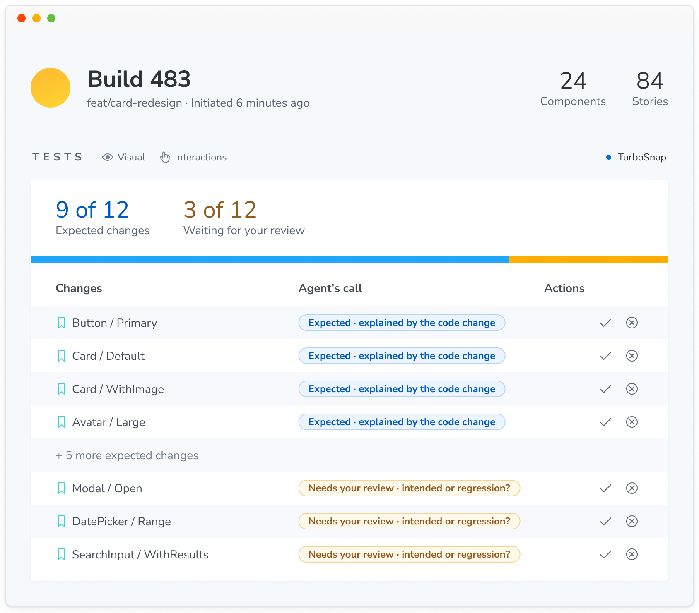

import { BetaBadge } from '../../components/BetaBadge';

# Run Chromatic with cloud agents<BetaBadge />

Hand tasks to a coding agent and get back pull requests you can trust. In a software factory, a cloud agent picks up a ticket, writes the code, opens a pull request, and reads the Chromatic build to find out if the UI is right. It fixes what it can and leaves visual changes for a person to review.


## Why software factories need Chromatic

A software factory only saves time if its pull requests don't need redoing. For UI, that depends on whether the agent can see what it built: in the State of AI in Frontend Delivery 2026 survey of 496 frontend engineers, UI changes from agents that couldn't see the rendered UI needed a rewrite about twice as often (19% vs. 10%).

Chromatic gives the agent that view and tells it what to fix: broken stories, accessibility violations, and visual changes that don't match its code. Developers only review the visual changes that need a decision.

## Set up

### 1. Connect your agent to the Chromatic MCP server

Add `https://mcp.chromatic.com/mcp` to your cloud agent's MCP settings ([Claude Desktop and claude.ai](/docs/mcp#claude-desktop), or [add the MCP server by hand](/docs/mcp#add-the-mcp-server-by-hand)) and authenticate. After that, every session the agent runs can use the Chromatic tools without asking again.

**The agent acts as the person who logged in.** It has that person's access. It sees the projects that person can see, and anything it changes in Chromatic counts as that person's action. If that person leaves your Chromatic account, the agent loses access with them.

### 2. Give cloud agents the skills

To give every cloud agent the skills, we recommend installing them in your repository with the skills CLI:

```shell
npx skills add chromaui/chromatic-plugins
```

Leave out `--global` so the skills go in the project, not your home folder. Commit them. Any agent that runs in the repository picks them up.

### 3. Tell your agent to respond to Chromatic

Add these instructions to `AGENTS.md` or your agent platform's equivalent:

```markdown
After you push, check the latest Chromatic build for this branch.

- Fix broken stories and new accessibility violations, push, and check the next build.
- Repeat until the build has no broken stories or new violations.
- List the remaining visual changes in the pull request for a person to review. Don't accept them.
- Mark the pull request ready only once the Chromatic build has finished. A passing CI job doesn't mean the UI passed.
- To test a UI change, add or update a story. Don't write a separate page-level test for the same thing.
```

See [Mandatory PR checks](/docs/mandatory-pr-checks#check-status-by-scenario) for what each build status means.

### 4. Review the changes that need a decision

The agent works through Chromatic's findings on its own. It fixes broken stories and accessibility violations, then uses the skills from step 2 to check whether each visual change matches the code on its branch.

You only step in when a change needs your call: is it an intended update or a regression? You review those few changes, not every snapshot.



## Next steps

- [**Set up the Chromatic MCP server:**](/docs/mcp) See the tools it offers, how to add it to your agent, and how access works.
- [**See what each skill does:**](/docs/skills) Learn what the skills check and when your agent uses them.
- [**Build your own workflows with the API:**](/docs/api) Query builds, tests, and accessibility results from your own scripts, bots, and dashboards.
