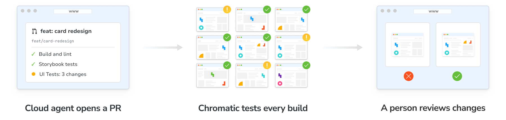

import { BetaBadge } from '../../components/BetaBadge';

# Run Chromatic with cloud agents<BetaBadge />

You want to hand tasks to a coding agent and get back pull requests you can trust. A cloud agent picks up a ticket, writes the code, opens a pull request, and reads the Chromatic build to find out if the UI is right. It fixes what it can and leaves visual changes for a person to review.



Set up this workflow in three steps:

1. [Connect your agent to Chromatic](#1-connect-your-agent-to-chromatic)
2. [Give cloud agents the skills](#2-give-cloud-agents-the-skills)
3. [Tell your agent to respond to Chromatic](#3-tell-your-agent-to-respond-to-chromatic)

## 1. Connect your agent to Chromatic

There are two ways to connect:

| Connection                                       | Use when                                                                     | Acts as                              |
| ------------------------------------------------ | ---------------------------------------------------------------------------- | ------------------------------------ |
| [Chromatic MCP](#connect-the-chromatic-mcp)      | Your agent platform supports remote MCP servers and someone can log in once  | The person who logged in             |
| [Service client](#connect-with-a-service-client) | No one can log in through a browser, or you want access owned by the account | Your Chromatic account, not a person |

### Connect the Chromatic MCP

Add `https://mcp.chromatic.com/mcp` to your cloud agent's MCP settings, then log in once in your browser when you set it up. After that, every session the agent runs can use the Chromatic tools without asking again.

{/* TODO: confirm how long a cloud login lasts and what happens when it expires (re-login prompt? silent failure?). */}

In Claude Code, adding the server to your Claude account as a connector makes it available in cloud sessions. See [Claude Desktop and claude.ai](/docs/mcp#claude-desktop) for the steps. For other platforms, see [Add the MCP server by hand](/docs/mcp#add-the-mcp-server-by-hand).

#### The agent acts as the person who logged in

It has that person's access. It sees the projects that person can see, and anything it changes in Chromatic counts as that person's action. If that person leaves your Chromatic account, the agent loses access with them.

For a shared factory that should keep working regardless of who set it up, use a [service client](#connect-with-a-service-client) instead.

For what the login grants and how to revoke it, see [Security and access](/docs/mcp#security-and-access).

### Connect with a service client

A service client lets an agent call the [Chromatic API](/docs/api) with no one logged in. It belongs to your Chromatic account, so it keeps working when people come and go.

1. [Create a service client](/docs/oauth-clients#create-a-service-client) with only the scopes the agent needs. For checking builds, that's `project:read` and `build:read`.
2. Store the client ID and secret in your agent platform's secret manager. Never commit them.
3. Have the agent exchange them for an access token with the [client credentials flow](/docs/api#client-credentials-m2m), then query [`project`](/docs/api#project) and [`build`](/docs/api#build).

Tokens expire after 60 minutes and there's no refresh token, so the agent requests a new one when the current one expires.

{/* TODO: confirm whether the Chromatic MCP accepts a service client token. If it does, add that path here and drop step 3. */}

## 2. Give cloud agents the skills

Cloud sessions don't load plugins, so a cloud agent gets the Chromatic tools but not the [skills](/docs/skills) or the hooks that check the build after a push.

The skills call the Chromatic MCP tools, so this step applies when your agent connects through the MCP. An agent with a service client calls the API directly.

To give every cloud agent the skills, install them in your repository and commit them:

```shell
npx skills add chromaui/chromatic-plugins
```

Leave out `--global` so the skills go in the project, not your home folder. Any agent that runs in the repository picks them up.

{/* TODO: confirm with eng that committing project-level skills is a pattern we recommend, and which folder the skills CLI writes to. */}

## 3. Tell your agent to respond to Chromatic

Once these instructions are in place, the agent checks the build after every push on its own and keeps fixing until only judgment calls are left. You don't have to prompt it.

Without the plugin's hooks, nothing tells a cloud agent to check the build after it pushes. Put that in the agent's instructions, in `AGENTS.md`, `CLAUDE.md`, or your platform's equivalent:

```markdown
After you push, check the latest Chromatic build for this branch.

- Fix broken stories and new accessibility violations, push, and check the next build.
- Repeat until the build has no broken stories or new violations.
- List the remaining visual changes in the pull request for a person to review. Don't accept them.
- Mark the pull request ready only once the Chromatic build has finished. A passing CI job doesn't mean the UI passed.
```

See [Mandatory PR checks](/docs/mandatory-pr-checks#check-status-by-scenario) for what each build status means.

## You only need to review what needs human judgment

The agent handles broken stories and accessibility violations. You decide on the visual changes, because only a person can tell an intended change from a regression.

Keep accepting, denying, and quarantining with a person:

- **With the MCP,** pre-approve only the tools that read, and leave `chromatic_mutate` out.
- **With a service client,** don't grant `build:write`.

An unattended run, such as `claude -p`, follows the instructions from [step 3](#3-tell-your-agent-to-respond-to-chromatic) and checks Chromatic itself, but needs the read-only tools allowed by name. With the plugin, tool names start with `mcp__plugin_chromatic_chromatic__`:

```shell
claude -p "Implement ABC-123 and open a pull request" \
  --allowedTools "mcp__plugin_chromatic_chromatic__chromatic_get_latest_build,mcp__plugin_chromatic_chromatic__chromatic_query,mcp__plugin_chromatic_chromatic__chromatic_search_schema,mcp__plugin_chromatic_chromatic__chromatic_list_accessibility_changes,mcp__plugin_chromatic_chromatic__chromatic_get_accessibility_diff,mcp__plugin_chromatic_chromatic__chromatic_server_time"
```

That list is every tool that only reads. The machine must have logged in once through `/mcp`.
