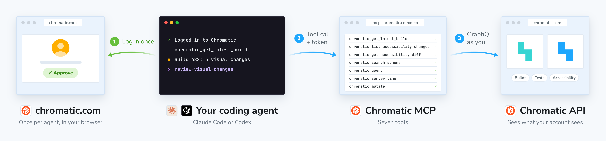
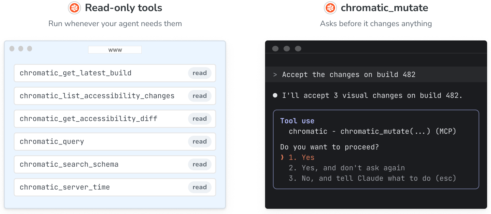
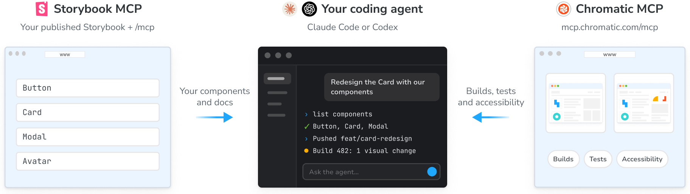

import { BetaBadge } from '../../components/BetaBadge';

# Chromatic MCP<BetaBadge />

The Chromatic MCP server (https://mcp.chromatic.com/mcp) connects your coding agent to Chromatic. Your agent can read your builds, test results, accessibility violations, and project-level information.

You log in once per agent, in your browser, using your Chromatic account. The server uses the Chromatic API on your behalf, and the agent inherits your account's access and permissions.

<div class="aside">
  Want to publish your Storybook's MCP server? See [Publish your Storybook
  MCP](/docs/storybook-mcp).
</div>



## Tools

The server gives your agent tools that read your Chromatic data, such as getting the latest build on a branch (`chromatic_get_latest_build`), showing a story's accessibility violations, and querying the Chromatic API. [Skills](/docs/skills) chain these tools with your code.



While most tools are read-only, `chromatic_mutate` can take actions: accept or deny a test, quarantine tests, or create a project. It runs only when you ask, your agent says what it will change first, and your client asks you to approve each call.

The server tells your agent which tools it has, so ask "What Chromatic tools do you have?" for the current list. For the limits, see [What can't the MCP server do?](#what-it-wont-do).

## Install with the plugin

The Chromatic plugin for Claude Code and Codex is the recommended way to set up the Chromatic MCP. It handles the configuration and installs the [skills](/docs/skills) too. In Claude Code it also adds hooks that check your build after you push. To install it, see [Install the Chromatic plugin for your agent](/docs/agents#1-install-the-chromatic-plugin-for-your-agent).

## Add the MCP server by hand

Adding the server by hand gives your agent the tools but **none of the skills**. Use it when your agent has no plugins, when you want the server in Claude Desktop or claude.ai, or when you use another agent.

<details id="claude-code">

<summary>Claude Code</summary>

```shell
claude mcp add --transport http --scope user chromatic https://mcp.chromatic.com/mcp
```

Then start a session, run `/mcp`, choose **chromatic**, and approve the request in your browser. In the desktop app, send any first message before you run `/mcp`. `--scope user` makes the server available in every project.

</details>

<details id="codex">

<summary>Codex</summary>

```shell
codex mcp add chromatic --url https://mcp.chromatic.com/mcp
codex mcp login chromatic
```

Approve the request in your browser. `codex mcp list` should show OAuth next to chromatic. This needs Codex 0.148 or newer; check with `codex --version`.

</details>

<details id="claude-desktop">

<summary>Claude Desktop and claude.ai</summary>

This adds the server as a connector, which gives you the tools.

1. Open **Customize » Connectors**, click **+**, and choose **Add custom connector**.
2. Enter `https://mcp.chromatic.com/mcp`. Leave the OAuth client ID and secret empty.
3. Click **Connect** and approve the request on chromatic.com.

**On a Team or Enterprise plan**, an owner adds the connector once, then each person connects:

1. An owner opens **Organization settings » Connectors » Add » Custom » Web** and enters `https://mcp.chromatic.com/mcp`. Members cannot add custom connectors themselves.
2. Each member opens **Customize » Connectors**, finds Chromatic marked "Custom", and clicks **Connect**. Everyone logs in to Chromatic as themselves, so nobody sees a project that their own account cannot.
3. Owners can set each tool to **Always allow**, **Needs approval**, or **Blocked** for the whole organization. **Always allow** is a reasonable default for the tools that only read. Keep `chromatic_mutate` on **Needs approval**.

Connectors run from Anthropic's cloud. `mcp.chromatic.com` and `www.chromatic.com` are both public, so there is nothing to allowlist.

</details>

<details id="chatgpt-app">

<summary>ChatGPT app</summary>

The ChatGPT app shares its setup with the Codex CLI.

1. Run the two commands under [Codex](#codex).
2. Quit and reopen the app, then pick **Codex** in the sidebar.
3. **Settings » MCP servers** lists chromatic. If you skipped the login, use **Authenticate** there.

</details>

<details id="other-agents">

<summary>Other agents</summary>

In your agent's MCP settings, add a remote server with the URL `https://mcp.chromatic.com/mcp` (Streamable HTTP). Leave any OAuth client ID and secret empty: your agent identifies itself with a client metadata document (CIMD) when it logs in, and your browser opens chromatic.com for you to approve the request. Any agent that supports remote MCP servers over Streamable HTTP and logs in with CIMD can connect; see [Which clients are supported?](#which-clients-are-supported) for what Chromatic has tested.

</details>

Then ask "What time is it on the Chromatic server?" to check the connection.

To get the skills after adding the server by hand, see [Get the skills](/docs/skills#get-the-skills). A skill is instructions, not a connection. Without the server connected, a skill has nothing to call.

## Project ID

Every tool needs your Chromatic project ID. It lives in [`chromatic.config.json`](/docs/cli#chromatic-config-file) at the root of your repository, as `projectId`:

```json title="chromatic.config.json"
{
  "projectId": "Project:64262bbd2f7d4ac4d7c5a7f3"
}
```

**With the plugin,** ask your agent to connect your Chromatic project (the `connect-project` skill). Since plugin v0.4.0, it finds the project from your Git remote, so most repositories no longer need a link. If it finds none, it asks you to paste a link to the project, then writes the file and tells you to commit it.

**Without the plugin,** copy the `appId` from any Chromatic project URL into that file. Prefix the hex ID with `Project:`, for example `"projectId": "Project:64262bbd2f7d4ac4d7c5a7f3"`.

**In Claude Desktop or claude.ai,** paste the project link into the chat.

<div class="aside">
  A project token is not a project ID. Your agent never asks for your project token and the server
  refuses to read one, except the token of a project the agent just created, which comes back once
  so you can set up CI. See [What can't the MCP server do?](#what-it-wont-do).
</div>

## Security and access

When you log in, your agent gets a token that acts as you. The token expires after 60 minutes and your agent refreshes it on its own. The login requests these [scopes](/docs/api#scopes-reference):

| Scope            | Lets your agent                                              |
| ---------------- | ------------------------------------------------------------ |
| `user:read`      | Read your profile                                            |
| `account:read`   | Read your accounts and their projects                        |
| `account:write`  | Read billing and plan details                                |
| `project:read`   | Read project details, branches, and the latest build         |
| `project:write`  | Create a project                                             |
| `build:read`     | Read builds, tests, and accessibility results                |
| `build:write`    | Accept or deny changes, and quarantine or unquarantine tests |
| `storybook:read` | Read published Storybook URLs                                |

Your role in Chromatic still applies. Your agent sees only the projects you can see and can't do anything you couldn't do yourself.

### Revoke access

- **Log out an agent by clearing its login:** In Claude Code, run `/mcp`, choose **chromatic**, then **Clear authentication**. In Codex, run `codex mcp logout chromatic`.
- **Remove a person:** when someone is removed from your Chromatic account, or can no longer log in to Chromatic, their agents lose access too.

There's no setting to turn off MCP access for a whole account. Access follows each person's role, so manage it through [collaborators](/docs/access/collaborators) and [SSO](/docs/access/sso).

On Claude Team and Enterprise plans, owners can also control the Chromatic connector for the whole organization, including blocking individual tools. See [Claude Desktop and claude.ai](#claude-desktop).

### Automation without a browser login

For agents that run without browser-based authentication, use a [service client](/docs/oauth-clients) instead. A service client belongs to your account, has only the scopes you grant it, and can be revoked by deleting it.

For cloud-based agents or software factories, see [Run Chromatic with cloud agents](/docs/cloud-agents).

## Chromatic MCP vs. Storybook MCP



**Chromatic MCP** lives at `https://mcp.chromatic.com/mcp`, one server for every project. It serves your builds, tests, accessibility results, and Chromatic data. Use it to review, fix, and ship UI changes tested by Chromatic.

**Storybook MCP** lives at your published Storybook's URL plus `/mcp`, one server per Storybook. It serves that Storybook's own components and docs. Use it to generate code that uses your components correctly.

The Chromatic plugin does not connect the Storybook MCP, because its address includes your project. To set it up, see [Publish your Storybook MCP](/docs/storybook-mcp).

---

## Frequently asked questions

<details id="which-clients-are-supported">

<summary>Which clients are supported?</summary>

Chromatic builds and tests the Chromatic MCP with these clients:

- **Claude Code (terminal and desktop app):** the plugin, skills, and hooks.
- **Codex CLI and the ChatGPT app:** the plugin and skills, no hooks.
- **Claude Desktop and claude.ai:** the tools only, with no plugin, skills, or hooks.

Any other client that speaks Streamable HTTP and logs in with a client metadata document (CIMD) can connect to `https://mcp.chromatic.com/mcp`. Leave any client ID and secret empty. Cursor can't log in yet; it's adding CIMD support.

</details>

<details id="run-without-a-person-watching">

<summary>Can I run it without a person watching?</summary>

Yes. Pre-approve every Chromatic tool except `chromatic_mutate`, so the agent can read builds but can't change anything. See [Tools](#tools) for which tools only read.

</details>

<details id="what-it-wont-do">

<summary>What can't the MCP server do?</summary>

- **Reply to or resolve a reviewer comment.** It reads comments and drafts a reply for you to post.
- **Start a build from the server.** Builds run from your CI, or from your machine with `run-build`.
- **Change project settings,** such as turning on accessibility tests or changing browsers. It gives you the link to the **Manage** screen.
- **Read your project token or Figma token.** Copy a token from the project's **Manage** screen yourself. The only exception is the token of a project the agent just created, which comes back with a note to save it as a CI secret.

</details>

<details id="skills-missing">

<summary>Why are the skills missing when the tools work?</summary>

The server was likely added without the plugin, as a connector or with `mcp add`. [Install the plugin](/docs/agents#1-install-the-chromatic-plugin-for-your-agent) or [get the skills](/docs/skills#get-the-skills).

</details>

<details id="tools-missing">

<summary>Why are the tools missing when the skills are installed?</summary>

Skills do not install the MCP server, make sure that you've added it separately, either with the plugin or by following the [Add the MCP server by hand](#add-the-mcp-server-by-hand) instructions.

</details>

<details id="refused-for-scope">

<summary>
  Why does my agent get "refused for scope", or fail to execute any actions, or see my account?
</summary>

Your login does not carry the permissions the tool needs. Log in again with `/mcp` or `codex mcp login chromatic`. In Claude Code, choose **Clear authentication** in `/mcp` first; in Codex, run `codex mcp logout chromatic` first. Until then, the skills give you a link to do it in Chromatic.

</details>

<details id="project-not-found">

<summary>Why can't my agent find my project?</summary>

It needs the project ID, which is the `appId` in a Chromatic project URL and not your project token. Run the `connect-project` skill and paste a link to the project. See [Project ID](#project-id).

</details>

<details id="no-accessibility-results">

<summary>Why are there no accessibility results?</summary>

Turn on [accessibility tests](/docs/accessibility) for the project and run a new build. Builds from before you turn them on have no accessibility data, and your agent reports accessibility as "not measured".

</details>

<details id="calls-fail-after-update">

<summary>Why do calls fail after an update?</summary>

Restart the session so the agent reloads the tool list. In Claude Code you can also reconnect with `/mcp`.

</details>

<details id="result-saved-to-file">

<summary>Why does Claude Code say a tool result was saved to a file?</summary>

Claude Code does that for any answer over 50,000 characters, and the agent reads the file. Nothing is wrong. The server refuses answers over 100,000 characters rather than cutting them short, and the agent then asks for fewer fields or pages through the list.

</details>

<details id="no-check-after-push">

<summary>Why doesn't my agent check the build after a push?</summary>

Your agent checks on its own only in Claude Code, in a repository with a `chromatic.config.json`. Run `connect-project` to add one. To be woken when the build finishes, the agent also needs the `gh` CLI logged in (check with `gh auth status`) and a GitHub remote. See [What the plugin runs on its own](/docs/skills#what-the-plugin-runs-on-its-own).

</details>

<details id="update-did-not-arrive">

<summary>Why didn't a plugin update arrive?</summary>

Your agent keeps a copy of the plugin. Run the [update steps](/docs/agents#update-the-plugin) and restart the session, or remove and reinstall the plugin.

</details>

For help with the Chromatic MCP, the plugin, a build, or your account, [contact Chromatic support](/docs/support). Include your agent, what you asked, and what it said.
