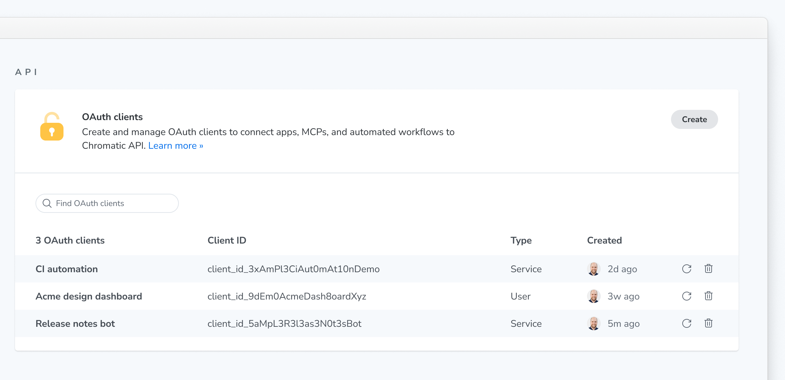
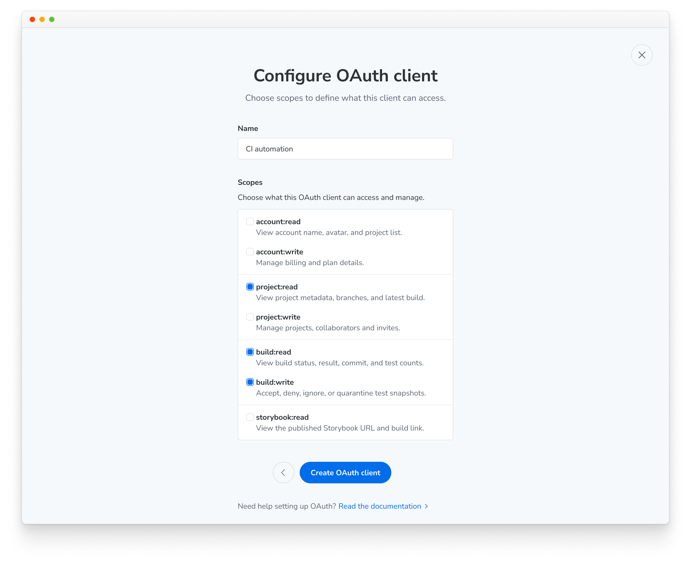
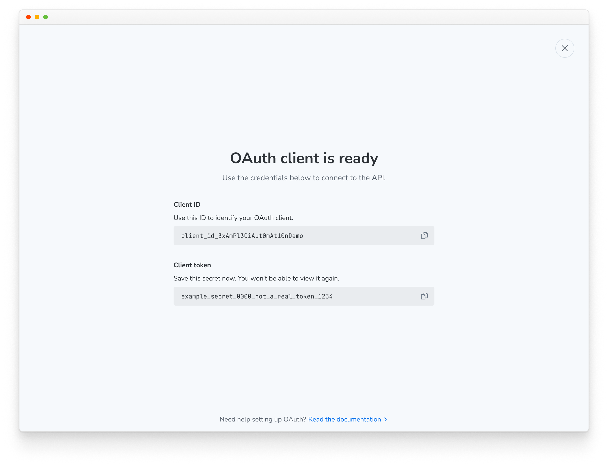
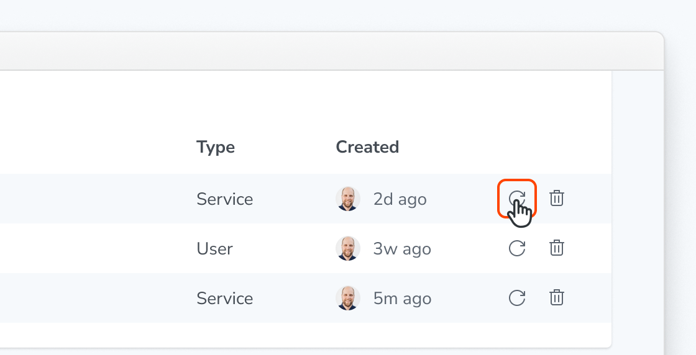

# OAuth clients

An OAuth client is how an app, MCP server, or automated workflow authenticates with the [Chromatic API](/docs/api). Each client has a client ID, a set of scopes that limit what it can do, and a type that decides which OAuth 2.0 flow it uses.

| Type               | Use when                                                                                       | Flow                                                                   | Credentials                 |
| ------------------ | ---------------------------------------------------------------------------------------------- | ---------------------------------------------------------------------- | --------------------------- |
| **Service** client | Headless automation runs with no user present, such as a CI pipeline, bot, or service          | [Client credentials (M2M)](/docs/api#client-credentials-m2m)           | Client ID and client secret |
| **User** client    | An agent or tool acts on behalf of a signed-in user, such as local development or an IDE agent | [Authorization code with PKCE](/docs/api#authorization-code-with-pkce) | Client ID and redirect URIs |

Service clients belong to an account, not a person, so they keep working when the admin who created them leaves. You can create them yourself from your account settings or with the API.

<div class="aside">

Creating user clients from Chromatic is coming soon. Until then, [contact support](/docs/support) and we'll set one up for you.

</div>

## Prerequisites

You are an **admin** of the account you want to create the client for. Only account admins can see the **OAuth clients** section.

## Find your OAuth clients

OAuth clients live on your account's **Settings** page, in the **OAuth clients** section under **API**.

The table lists every OAuth client on the account, with a search field to find one by name. For each client it shows:

- **Name**: the display name you gave the client.
- **Client ID**: the ID your integration uses to authenticate.
- **Type**: **User** or **Service**.
- **Created**: the admin who created it and when.



If the account has no OAuth clients yet, the section shows only the **Create** button.

You can't change a client's name or scopes after you create it. To change them, create a new client with the settings you want, move your integration over to it, and then delete the old one.

## Create a service client

1. On the account's **Settings** page, find the **OAuth clients** section and click **Create**.
2. On the **Create OAuth client** screen, choose **Service**.
3. On the **Configure OAuth client** screen, enter a **Name** for the client.
4. Under **Scopes**, select what the client can access. See [Scopes](#scopes) for what each one unlocks. Grant only what your automation needs.

   

5. Click **Create OAuth client**.

The **OAuth client is ready** screen shows the **Client ID** and **Client token** (the client secret). Use the copy buttons to store both in your CI provider's secret manager or another secure store.



<div class="aside">

🚨&nbsp;&nbsp;The client secret is shown **only once**. Chromatic stores it hashed and can't show it to you again. If you close the screen without saving it, [rotate the secret](#rotate-a-client-secret) to get a new one.

</div>

## Rotate a client secret

Rotate a secret when it may have leaked, when someone who had it leaves your team, or when you've lost it.

1. In the **OAuth clients** table, find the client and click the **Rotate secret** icon on its row.

   

2. Your browser asks you to confirm. Click **OK**.

The **Client secret rotated** screen shows the client ID and the new client secret. Copy the new secret now; like the original, it's shown only once.

Rotating invalidates the current secret immediately. Any integration still using it can't authenticate until you update it with the new secret, so have the new value ready to deploy before you rotate. The client ID and scopes stay the same.

## Delete a client

1. In the **OAuth clients** table, find the client and click the **Remove OAuth client** (trash) icon on its row.
2. Your browser asks you to confirm. Click **OK**.

Deleting a client immediately revokes its access and invalidates its credentials. Any integration using it can no longer authenticate. This can't be undone.

## Create a service client with the API

If you'd rather script client creation, run the `createOAuthClient` mutation. It creates service clients only. Listing, rotating, and deleting clients are available only from **Settings** for now.

### Find your account ID

Sign in to Chromatic and go to [https://www.chromatic.com/apps](https://www.chromatic.com/apps). Select the account you want from the account picker, then read the `accountId` query parameter out of the URL:

```bash
https://www.chromatic.com/apps?accountId=689126b1bf7b127209b4c5b1
```

Here the account ID is `689126b1bf7b127209b4c5b1`.

### Open the GraphQL explorer

While signed in, go to [https://www.chromatic.com/api](https://www.chromatic.com/api). This is an Apollo Studio explorer where you can browse the schema and run queries and mutations as yourself.

### Run the createOAuthClient mutation

Paste this mutation into the explorer:

```graphql
mutation CreateOAuthClient($input: CreateOAuthClientInput!) {
  createOAuthClient(input: $input) {
    clientId
    clientSecret
    name
    scopes
  }
}
```

And these variables, replacing `<account_id>` with the ID you found above:

```json
{
  "input": {
    "accountServiceClient": {
      "accountId": "<account_id>",
      "name": "CI Automation",
      "scopes": [
        "account:read",
        "account:write",
        "build:read",
        "build:write",
        "project:read",
        "project:write",
        "storybook:read"
      ]
    }
  }
}
```

The `scopes` list above requests everything a service client can do. Remove the scopes your automation doesn't need. A client can only ever request the scopes it was created with, so granting the minimum keeps the credentials less valuable if they leak.

`name` is optional. It's the display name for the client and the machine user behind it, and it defaults to your account name. Names may only contain letters, numbers, spaces, periods, dashes, and underscores.

A successful response looks like this:

```json
{
  "data": {
    "createOAuthClient": {
      "clientId": "4f3c9a1e7b2d48f0a6c5e9d3b7182a4c",
      "clientSecret": "9f8e7d6c5b4a392817065f4e3d2c1b0a8f7e6d5c4b3a29180716f5e4d3c2b1a0",
      "name": "CI Automation",
      "scopes": [
        "account:read",
        "account:write",
        "build:read",
        "build:write",
        "project:read",
        "project:write",
        "storybook:read"
      ]
    }
  }
}
```

<div class="aside">

🚨&nbsp;&nbsp;The `clientSecret` is returned **only once**, in this response. Chromatic stores it hashed and can't show it to you again. Copy it now into your CI provider's secret manager or another secure store. If you lose it, [rotate the secret](#rotate-a-client-secret).

</div>

The new client also appears in the **OAuth clients** table on the **Settings** page.

## Scopes

Scopes follow a `subject:action` pattern. A client can only request the scopes it was created with. The [scopes reference](/docs/api#scopes-reference) on the API page lists the same scopes.

| Scope            | What it unlocks                                                                                                                   |
| ---------------- | --------------------------------------------------------------------------------------------------------------------------------- |
| `account:read`   | `account` query: account name, avatar, projects list                                                                              |
| `account:write`  | `account.subscription` field: billing and plan details                                                                            |
| `project:read`   | `project` query: project metadata, branch names, last build                                                                       |
| `project:write`  | `projectCreate` mutation: create a project on the account                                                                         |
| `build:read`     | `build` query: build status, result, commit, test counts                                                                          |
| `build:write`    | `reviewTest`, `testQuarantine`, and `testUnquarantine` mutations: accept or deny test snapshots, quarantine or unquarantine tests |
| `storybook:read` | `storybook` query: published Storybook URL and build link                                                                         |

Service clients act on behalf of an account, not a user, so the `user:read` scope isn't available to them and the `viewer` query can't be used. Use the [`account`](/docs/api#account) query as your entry point instead.

## Next steps

Exchange your service client's ID and secret for an access token using the [client credentials flow](/docs/api#client-credentials-m2m). If Chromatic set up a user client for you, use the [authorization code flow with PKCE](/docs/api#authorization-code-with-pkce) instead. Then start [making requests](/docs/api#making-requests).

Treat the client secret like a password. Store it in a secret manager and never commit it to your repository.
