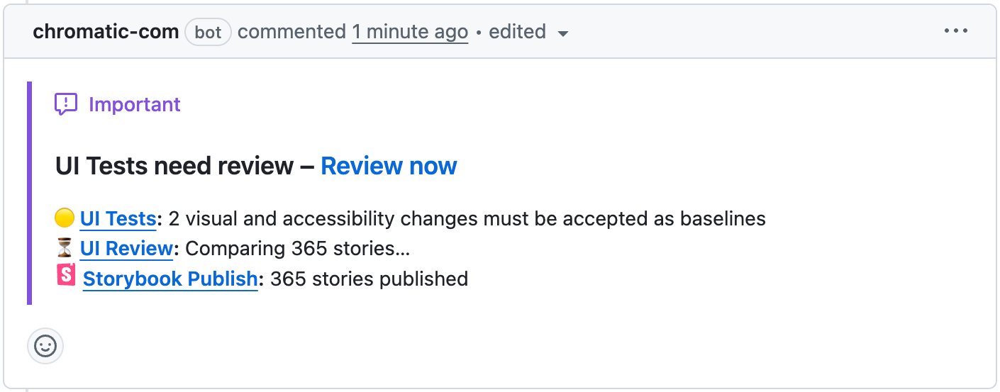
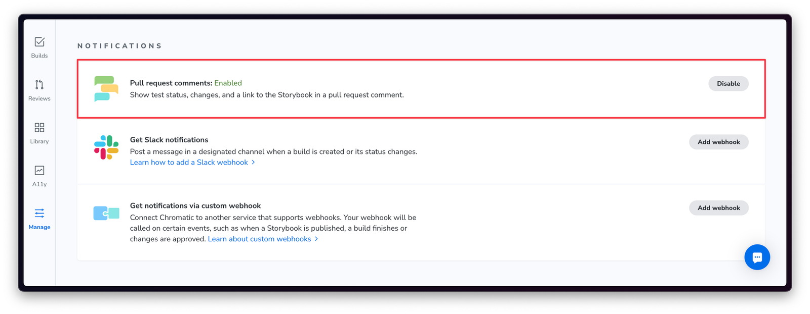

# PR comments

When enabled, Chromatic posts a comment on the pull request with the number of visual and accessibility changes, the UI Review status, and a link to your published Storybook.

## How it works

When a Chromatic build completes for a pull request, Chromatic posts a comment on that PR. The comment shows:

- **UI Tests:** the number of visual and accessibility changes that need to be accepted as baselines
- **UI Review:** the current review status
- **Storybook Publish:** a link to your published Storybook

The comment is created the first time a build posts results for a PR. From then on, it updates automatically with each new build on the same PR — no new comment is posted each time.

## Enable

PR comments require:

- [UI Review enabled](/docs/manual-ui-review#enable-ui-review) for the project.
- The project [linked to a GitHub repository](/docs/access#linked-projects).
- The Chromatic GitHub App (`chromatic-com`) installed with access to that repository.

Then enable PR comments from your project’s Manage screen under **Notifications**.

ℹ️ PR comments are currently only supported for **GitHub**. Support for other Git providers is coming soon.

## Monorepo support

For monorepos linked to multiple Chromatic projects, each project posts its own comment. Consolidation into a single comment is coming soon.

## Frequently asked questions

Why is the Enable button for PR comments disabled?

The **Enable** button is disabled and shows the message "Install the GitHub app to enable GitHub comments." when the Chromatic GitHub App (`chromatic-com`) does not have access to the repository linked to the project.

The Chromatic GitHub App is separate from the Chromatic OAuth App. Approving the OAuth App for your GitHub organization does not install the GitHub App. [Learn what each GitHub app controls »](/docs/faq/org-not-appearing#oauth-app-and-github-app)

Ask a GitHub organization owner to open **Settings » GitHub Apps » Chromatic** in the organization:

- If `chromatic-com` is installed on selected repositories, add the project’s repository under **Repository access**.
- If `chromatic-com` is not installed, [install it or request installation](/docs/faq/org-not-appearing#request-github-app-approval).

Reload the Manage screen after the owner grants access.

