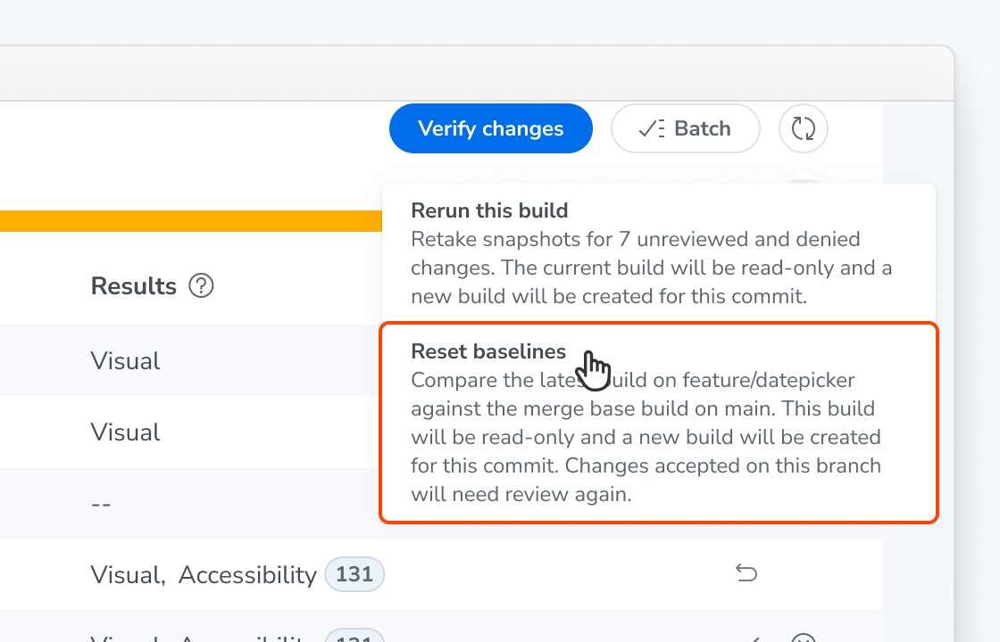
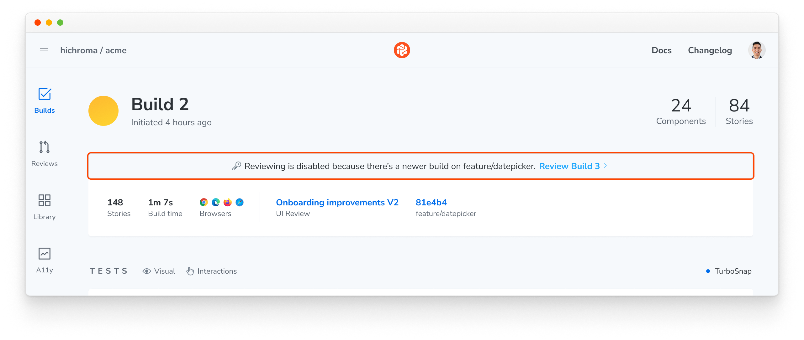

# Reset baselines

Chromatic picks baselines for a build from its [ancestor builds](/docs/branching-and-baselines#find-the-ancestor-builds) in your git history. Complex CI setups and git workflows can lead Chromatic to pick the wrong ancestor. When that happens, a pull request's build shows changes from the base branch that you didn't make, and rebasing doesn't fix it.

Resetting baselines starts your branch over from the base branch. Chromatic creates a new build for the same commit and compares it against the base branch, so you only see the changes your branch introduces. You don't need to close the pull request and reopen it under a new branch name.

## How a reset picks baselines

A reset uses the [merge base](/docs/branching-and-baselines#how-is-merge-base-calculated) build as the ancestor of the new build. That's the build on the base branch that your branch started from. Every baseline on your branch goes back to how it looks in that build.

The base branch is the base branch of the branch's [UI Review](/docs/review). If there's no UI Review, Chromatic uses the project's default branch.

## Reset a build's baselines

The option appears on the newest build on a branch, for collaborators with the [Developer role](/docs/access/collaborators#project-roles). It doesn't appear on builds on the base branch itself.

1. Go to the build's UI Tests page.
2. Click the rerun button next to **Batch**. The menu shows **Rerun this build** and **Reset baselines**. The **Reset baselines** description names the branch and the base branch it compares against.
3. Choose **Reset baselines**, then confirm in the browser dialog.

Chromatic starts a new build for the same commit. It captures visual snapshots for your stories and compares them with the baselines from the merge base build.

## What happens after a reset

- **The original build becomes read-only.** It shows a message that reviewing is disabled because there's a newer build on the branch, with a link to the new build.
- **The new build shows only your branch's changes, all unreviewed.** Changes you accepted on the original build need review again, and comments on its tests don't carry over.
- **A linked UI Review keeps its history.** The review shows the new build as its latest build. Its comments and approvals stay as they were.

## Why can't I reset a build?

If Chromatic can't find a merge base build to reset to, the menu shows **Baseline reset is not available** in place of the **Reset baselines** option. The usual causes are:

- **Chromatic doesn't run on your base branch.** With no builds on the base branch, there's nothing to reset to. Run Chromatic on every push to the base branch.
- **Your CI checks out a partial git history.** Chromatic needs enough history to find where your branch started from the base branch. Fetch the full commit history in CI, for example with `fetch-depth: 0` in [GitHub Actions](/docs/github-actions).
- **Your branch shares no history with the base branch.** For example, a branch created with `git checkout --orphan` has no merge base.
