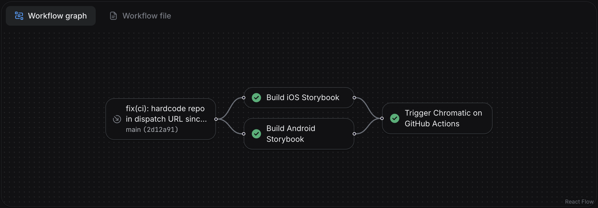

# Configure CI for React Native

Integrate Chromatic into your CI pipeline to get notified about any visual changes introduced by a pull request. Chromatic will run tests when you push code and report changes via the "UI Tests" badge for your pull request.

## Configure CI with GitHub Actions

Here's a sample GitHub Actions workflow (for Expo) that builds the Storybook app for iOS and Android in parallel, then runs Chromatic with the generated artifacts:

```yml title=".github/workflows/test.yml"
name: Build

on:
  pull_request:
    types: [opened, edited, synchronize]
  push:
    branches:
      - main

jobs:
  build-ios:
    runs-on: macos-latest
    steps:
      - name: Checkout
        uses: actions/checkout@v7
        with:
          fetch-depth: 0
      - name: Select Xcode
        run: sudo xcode-select -s /Applications/Xcode_26.3.app
      - name: Setup Node.js
        uses: actions/setup-node@v7
        with:
          node-version: 24.20.0
          cache: npm
      - name: Install dependencies
        run: npm ci
      - name: Cache CocoaPods spec repo
        uses: actions/cache@v6
        with:
          path: ~/.cocoapods
          key: cocoapods-specs-${{ hashFiles('package.json', 'app.json') }}
          restore-keys: |
            cocoapods-specs-
      - name: Cache Pods directory
        uses: actions/cache@v6
        with:
          path: ios/Pods
          key: ios-pods-${{ hashFiles('package.json', 'app.json') }}
          restore-keys: |
            ios-pods-
      - name: Build iOS
        run: npx --yes chromatic react-native-build --platform=ios --output-dir=build
      - name: Upload iOS build
        uses: actions/upload-artifact@v7
        with:
          name: ios-build
          path: build/
          retention-days: 1

  build-android:
    runs-on: ubuntu-latest
    steps:
      - name: Checkout
        uses: actions/checkout@v7
        with:
          fetch-depth: 0
      - name: Setup Node.js
        uses: actions/setup-node@v7
        with:
          node-version: 24.20.0
          cache: npm
      - name: Cache Gradle wrapper
        uses: actions/cache@v6
        with:
          path: ~/.gradle/wrapper
          key: gradle-wrapper-${{ hashFiles('package.json', 'app.json') }}
      - name: Cache Gradle dependencies
        uses: actions/cache@v6
        with:
          path: ~/.gradle/caches
          key: gradle-caches-${{ hashFiles('package.json', 'app.json') }}
          restore-keys: |
            gradle-caches-
      - name: Cache Android directory
        uses: actions/cache@v6
        with:
          path: android/
          key: android-dir-${{ hashFiles('package.json', 'app.json') }}
          restore-keys: |
            android-dir-
      - name: Install dependencies
        run: npm ci
      - name: Build Android
        run: npx --yes chromatic react-native-build --platform=android --output-dir=build
      - name: Upload Android build
        uses: actions/upload-artifact@v7
        with:
          name: android-build
          path: build/
          retention-days: 1

  chromatic:
    needs: [build-ios, build-android]
    runs-on: ubuntu-latest
    steps:
      - name: Checkout
        uses: actions/checkout@v7
        with:
          fetch-depth: 0
      - name: Setup Node.js
        uses: actions/setup-node@v7
        with:
          node-version: 24.20.0
          cache: npm
      - name: Install dependencies
        run: npm ci
      - name: Download iOS build
        uses: actions/download-artifact@v8
        with:
          name: ios-build
          path: build/ios
      - name: Download Android build
        uses: actions/download-artifact@v8
        with:
          name: android-build
          path: build/android
      - name: Move Storybook static files
        run: |
          mkdir -p storybook-static
          mv build/ios/storybook.app storybook-static/
          mv build/android/storybook.apk storybook-static/
      - name: Publish to Chromatic
        run: npx --yes chromatic -d storybook-static --exit-zero-on-changes --exit-zero-on-errors
        env:
          CHROMATIC_PROJECT_TOKEN: ${{ secrets.CHROMATIC_PROJECT_TOKEN }}
```

## Configure CI with EAS Build

If you already build with [EAS Build](https://docs.expo.dev/build/introduction/), you can build the Storybook artifacts on EAS instead of on GitHub-hosted runners, keeping your credentials and build profiles in one place.

This is a two-part setup: an [EAS workflow](https://docs.expo.dev/eas/workflows/get-started/) builds the iOS `.app` and Android `.apk` artifacts in parallel, then triggers a GitHub Actions workflow that downloads them and runs Chromatic.

### 1. Add a Storybook build profile

Both platform builds use a dedicated `storybook` [build profile](https://docs.expo.dev/build/eas-json/) so the artifacts contain Storybook instead of your app. In `eas.json`, enable Storybook in the bundle and produce artifacts Chromatic can install—an iOS Simulator build and an Android APK:

```json title="eas.json"
{
  "build": {
    "storybook": {
      "ios": {
        "simulator": true
      },
      "android": {
        "buildType": "apk"
      },
      "env": {
        "EXPO_PUBLIC_STORYBOOK_ENABLED": "true"
      }
    }
  }
}
```

### 2. Build artifacts and trigger the GitHub workflow

The EAS workflow builds both platforms, then uses the build IDs to trigger the Chromatic workflow on GitHub Actions via a [repository dispatch](https://docs.github.com/en/rest/actions/workflows#create-a-workflow-dispatch-event).

```yml title=".eas/workflows/chromatic.yml"
name: Chromatic

on:
  push:
    branches: ['main']
  pull_request:
    branches: ['*']

jobs:
  build_ios:
    name: Build iOS Storybook
    type: build
    params:
      platform: ios
      profile: storybook
  build_android:
    name: Build Android Storybook
    type: build
    params:
      platform: android
      profile: storybook

  trigger_chromatic:
    name: Trigger Chromatic on GitHub Actions
    needs: [build_ios, build_android]
    steps:
      - name: Dispatch chromatic-eas workflow
        # 👇 Replace `<owner>/<repo>` with your repository.
        run: |
          curl --fail-with-body -sS -X POST \
            -H "Accept: application/vnd.github+json" \
            -H "Authorization: Bearer ${GH_DISPATCH_TOKEN}" \
            "https://api.github.com/repos/<owner>/<repo>/actions/workflows/chromatic-eas.yml/dispatches" \
            -d "{
              \"ref\": \"${{ github.ref_name || 'main' }}\",
              \"inputs\": {
                \"ios_build_id\": \"${{ needs.build_ios.outputs.build_id }}\",
                \"android_build_id\": \"${{ needs.build_android.outputs.build_id }}\"
              }
            }"
```

The `build_ios` and `build_android` jobs each expose a `build_id` output. The `trigger_chromatic` job passes those IDs to the GitHub workflow as inputs so it knows which artifacts to download.

`GH_DISPATCH_TOKEN` is a [GitHub personal access token](https://docs.github.com/en/authentication/keeping-your-account-and-data-secure/managing-your-personal-access-tokens) with `workflow` scope, both read and write. Store it as an [EAS environment variable](https://docs.expo.dev/eas/environment-variables/) (marked secret) so the workflow can authenticate the dispatch request.



### 3. Run Chromatic on GitHub Actions

The dispatched workflow receives the two EAS build IDs, downloads the artifacts with the [EAS CLI](https://docs.expo.dev/eas/), arranges them into a `storybook-static` directory using the `storybook.app` / `storybook.apk` names Chromatic expects, and runs Chromatic with `storybookBuildDir`.

```yml title=".github/workflows/chromatic-eas.yml"
name: Chromatic (EAS artifacts)

on:
  workflow_dispatch:
    inputs:
      ios_build_id:
        description: 'EAS build ID for the iOS Storybook build'
        required: true
        type: string
      android_build_id:
        description: 'EAS build ID for the Android Storybook build'
        required: true
        type: string

jobs:
  chromatic:
    runs-on: ubuntu-latest
    steps:
      - name: Checkout
        uses: actions/checkout@v7
        with:
          fetch-depth: 0
      - name: Setup Node.js
        uses: actions/setup-node@v7
        with:
          node-version: 24.20.0
          cache: npm
      - name: Install dependencies
        run: npm ci
      - name: Download EAS build artifacts
        env:
          EXPO_TOKEN: ${{ secrets.EXPO_TOKEN }}
        run: |
          mkdir -p storybook-static
          IOS_PATH=$(npx eas-cli build:download --build-id "${{ inputs.ios_build_id }}" --non-interactive --json | jq -r '.path')
          cp -R "$IOS_PATH" storybook-static/storybook.app
          ANDROID_PATH=$(npx eas-cli build:download --build-id "${{ inputs.android_build_id }}" --non-interactive --json | jq -r '.path')
          cp "$ANDROID_PATH" storybook-static/storybook.apk
      - name: Run Chromatic
        uses: chromaui/action@latest
        with:
          projectToken: ${{ secrets.CHROMATIC_PROJECT_TOKEN }}
          storybookBuildDir: storybook-static
          exitZeroOnChanges: true
```

This workflow needs two secrets in your GitHub repository:

- `EXPO_TOKEN` — an [Expo access token](https://docs.expo.dev/accounts/programmatic-access/) so the EAS CLI can download your builds.
- `CHROMATIC_PROJECT_TOKEN` — your Chromatic project token.

Because the artifacts already contain both platforms, Chromatic skips the build step and snapshots directly from `storybook.app` and `storybook.apk`, just like the [`--storybook-build-dir` flow](/docs/react-native/configure#reusing-an-existing-build).
