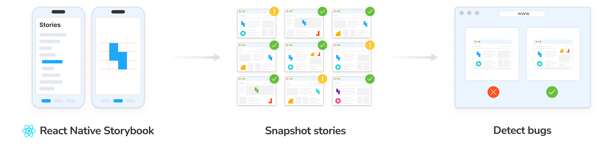
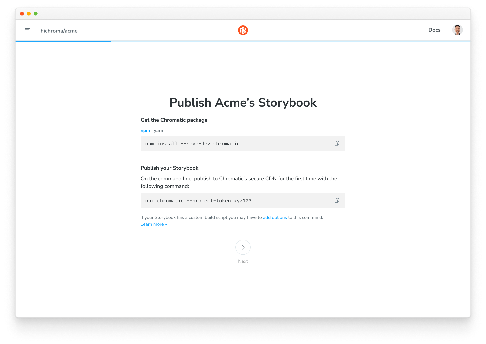
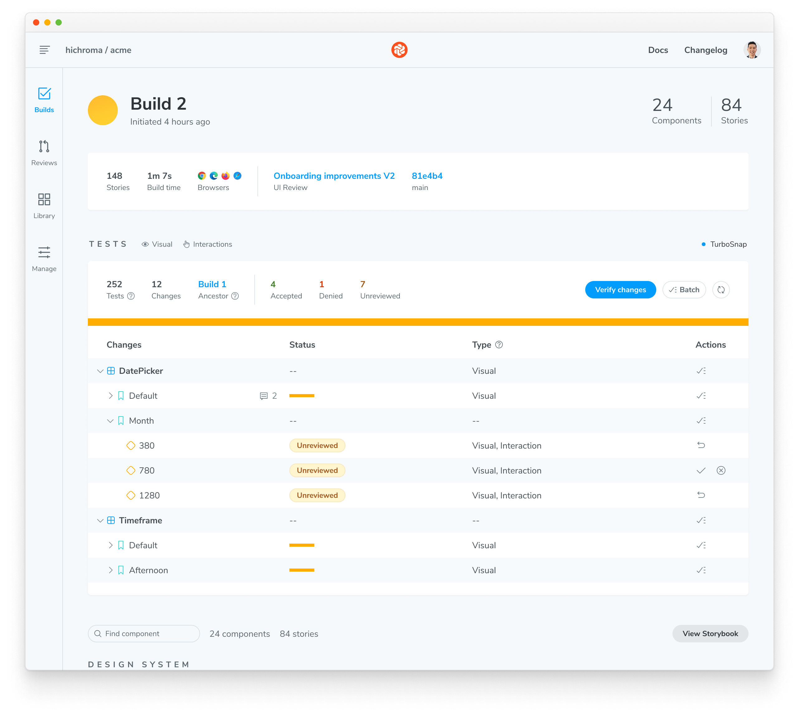
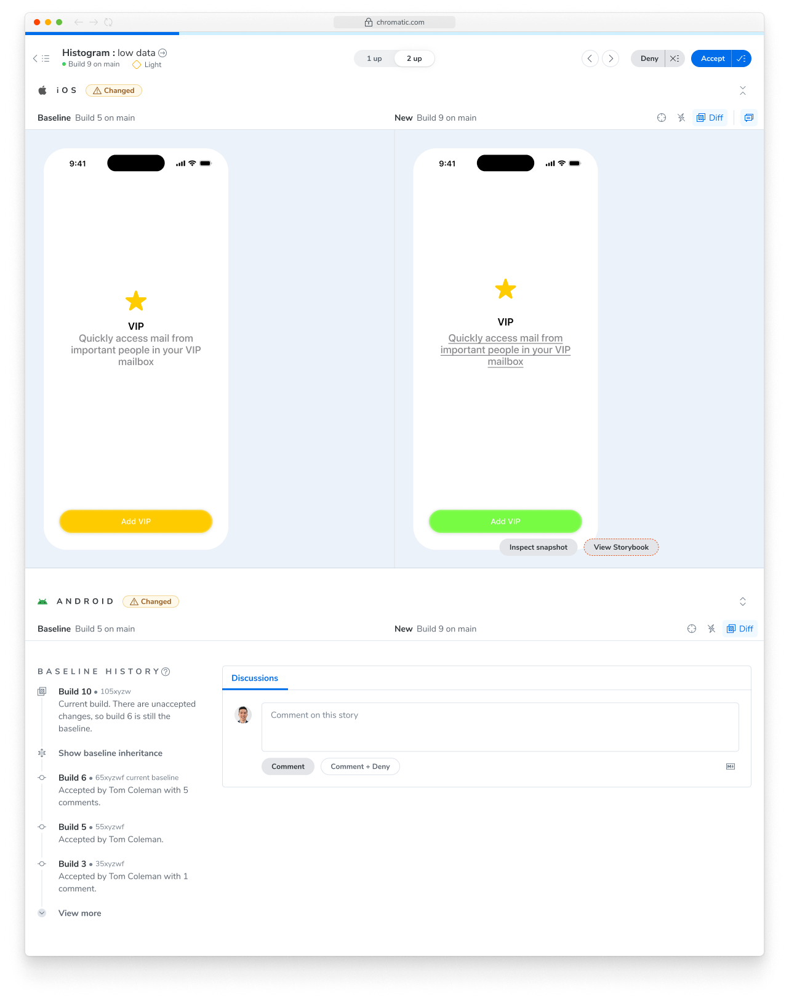
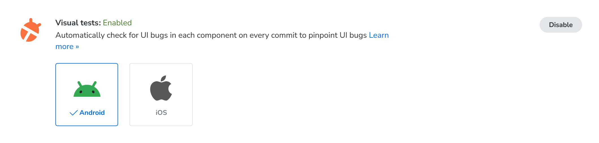

import DemoChromaticUnlinked from '../../shared-snippets/demo-chromatic-unlinked.mdx';
import InstallSnippets from '../../components/InstallSnippets.astro';
import { AICallout } from '../../components/AICallout';

# Chromatic for React Native

Chromatic enables you to visual test iOS and Android apps built with React Native. It's powered by [React Native for Storybook](https://storybookjs.github.io/react-native/docs/intro/), and your [stories](https://storybook.js.org/docs/get-started/whats-a-story) act as test cases.

Chromatic captures snapshots in the iOS Simulator on hosted macOS and the Android Emulator on hosted Linux, so you test exactly what your users see.



## Prerequisites

Before you start, make sure you have:

- A working React Native app ([Expo](https://expo.dev/), [Expo Router](https://docs.expo.dev/router/introduction/), [React Native CLI](https://reactnative.dev/docs/environment-setup), and [Re.Pack](https://re-pack.dev/) are all supported)
- [React Native for Storybook](https://storybookjs.github.io/react-native/docs/intro/) installed and running locally, v9.0 or higher
- A [Chromatic](https://www.chromatic.com) account

<details>
<summary>Don't have Storybook for React Native set up yet?</summary>

Use the Storybook CLI to get started. It handles all the set up: it wraps your bundler config with `withStorybook`, generates the Storybook entry point, and adds convenience scripts to your `package.json`.

```shell
npm create storybook@latest
```

</details>

## Set up Chromatic for React Native

The Chromatic CLI uploads your built React Native Storybook to the Chromatic cloud, where it runs on real iOS Simulator and Android Emulator instances and produces visual diffs against your baselines.

### 1. Sign up and create a new project

Generate a unique project token for your app by signing in to [Chromatic](https://www.chromatic.com/start) and creating a project. Sign in with your GitHub, GitLab, Bitbucket, or email.

Then reach out to your point of contact at Chromatic to enable React Native support for your project.

<DemoChromaticUnlinked />



If you bootstrapped a new React Native Storybook with v10.4+, Steps 2 and 3 aren’t required. When initializing a new project with v10.4+, Storybook handles all configuration automatically.

### 2. Ensure the root shows Storybook

Regardless of which router your project uses, you must return `<StorybookUI />` at the app's root when `STORYBOOK_ENABLED` or `EXPO_PUBLIC_STORYBOOK_ENABLED` is set.

For example, in `app/_layout.tsx`, you can conditionally render Storybook based on the environment variable:

```tsx title="app/_layout.tsx"
import { Stack } from 'expo-router';
import StorybookUI from '../.rnstorybook';

export default function RootLayout() {
  if (process.env.EXPO_PUBLIC_STORYBOOK_ENABLED === 'true') {
    return (
      <ThemeProvider value={colorScheme === 'dark' ? DarkTheme : DefaultTheme}>
        <StorybookUI />
      </ThemeProvider>
    );
  }

  // else render the normal app
  return (
    <Stack screenOptions={{ headerShown: false }}>
      <Stack.Screen name="(pages)/index" />
    </Stack>
  );
}
```

### 3. Configure Storybook UI using environment variables

Chromatic drives React Native Storybook via WebSockets and requires a few additional options to be enabled. These options must be controlled by environment variables read in `.rnstorybook/index.ts`.

```tsx title=".rnstorybook/index.ts"
import { view } from './storybook.requires';

const StorybookUIRoot = view.getStorybookUI({
  enableWebsockets: process.env.EXPO_PUBLIC_STORYBOOK_ENABLED === 'true',
  host: process.env.EXPO_PUBLIC_STORYBOOK_WEBSOCKET_HOST || 'localhost',
  port: parseInt(process.env.EXPO_PUBLIC_STORYBOOK_WEBSOCKET_PORT || '7007', 10),
  secured: process.env.EXPO_PUBLIC_STORYBOOK_WEBSOCKET_SECURED === 'true',
  onDeviceUI: process.env.EXPO_PUBLIC_STORYBOOK_DISABLE_UI !== 'true',
});

export default StorybookUIRoot;
```

### 4. Run your first build to establish baselines

Once you have a project token, you can establish baselines by running a Chromatic build for a new project. Chromatic builds your Storybook app, uploads it, captures a snapshot of each story, and sets those snapshots as the baseline.

Subsequent builds will generate new snapshots that are compared against existing baselines to detect UI changes.

{/* prettier-ignore-start */}

<InstallSnippets>
  <Fragment slot="npm">
  ```shell
  npx chromatic --project-token <your-project-token>
  ```
  </Fragment>
  <Fragment slot="yarn">
  ```shell
  yarn chromatic --project-token <your-project-token>
  ```
  </Fragment>
  <Fragment slot="pnpm">
  ```shell
  pnpm chromatic --project-token <your-project-token>
  ```
  </Fragment>
</InstallSnippets>

{/* prettier-ignore-end */}

The Chromatic CLI will build your Storybook `.apk` and/or `.app` for Expo based projects.

If you have a custom build process, you can also build the artifacts yourself and pass the directory to `chromatic` with the `--storybook-build-dir` flag. More on that in the [advanced configuration](#reusing-an-existing-build) docs.

### 5. Review changes

On each build, Chromatic compares new snapshots to existing baselines from previous builds. Try modifying a component a bit and running another Chromatic build.

When tests are complete, you'll see the build status and a link to review the changes. Click on that link to open Chromatic.

```shell
Build 2 published.

View it online at https://www.chromatic.com/build?appId=...&number=2.
```



The build will be marked "unreviewed" and the changes will be listed in the "Tests" table. Go through each snapshot to review the diff and approve or reject the change.

✅ **Accept change**: This updates the story baseline, ensuring future snapshots are compared against the latest approved version. Once a snapshot is accepted, it won't need re-acceptance until it changes, even across git branches or merges.

❌ **Deny change**: This marks the change as "denied", indicating a regression and immediately failing the build. You can deny multiple changes per build. Denying a change will force a re-capture on the next build.



---

## Next: run Chromatic in CI

[**Integrate Chromatic into your CI pipeline**](/docs/react-native/ci) to get notified about any visual changes introduced by a pull request. Chromatic runs tests any time you push code and reports changes via the “UI Tests” badge for your pull request.


<AICallout>

Connect your coding agent to Chromatic so it can tell you the status of each build after you push. [Chromatic for agents](/docs/agents)

</AICallout>

## Advanced configuration options

### Environment Variables

All build commands invoked by the Chromatic CLI set environment variables to properly configure your Storybook for visual testing. These environment variables let you control Storybook behavior without changing code, as [documented here](https://storybookjs.github.io/react-native/docs/intro/configuration/environment-variables).

The Chromatic CLI sets the following environment variables. It also sets them with the `EXPO_PUBLIC_` prefix for [use with Expo](https://docs.expo.dev/guides/environment-variables/).

| **Name**                                                | **Value**                            | **Description**                                      |
| ------------------------------------------------------- | ------------------------------------ | ---------------------------------------------------- |
| `STORYBOOK_ENABLED`                                     | `true`                               | Enables Storybook in bundle                          |
| `STORYBOOK_DISABLE_UI`                                  | `true`                               | Disables the Storybook manager UI                    |
| `STORYBOOK_SERVER`                                      | `false`                              | Do not start the channel server.                     |
| `STORYBOOK_WEBSOCKET_HOST` or `STORYBOOK_WS_HOST`       | `react-native.capture.chromatic.com` | Connects the Storybook to Chromatic capture systems. |
| `STORYBOOK_WEBSOCKET_PORT` or `STORYBOOK_WS_PORT`       | `7007`                               | Connects the Storybook to Chromatic capture systems. |
| `STORYBOOK_WEBSOCKET_SECURED` or `STORYBOOK_WS_SECURED` | `true`                               | Ensures the use of TLS when connecting to Chromatic. |

### Custom build commands

For non-Expo users or setups Chromatic doesn't currently account for, two escape-hatch options are available via the [config file](/docs/cli/#chromatic-config-file):

- [reactNative.iosBuildCommand](/docs/configure/#reactnative-iosbuildcommand)
- [reactNative.androidBuildCommand](/docs/configure/#reactnative-androidbuildcommand)

When set, the CLI invokes these commands instead of its defaults. The commands must output artifacts named `storybook.apk` and/or `storybook.app` to the directory specified by `CHROMATIC_ARTIFACT_DIRECTORY`.

### Reusing an existing build

Pass `--storybook-build-dir` to skip all build steps except `manifest.json` generation. This is most useful for parallelizing native builds across CI machines: one machine builds the Android artifact, another builds the iOS artifact, and a third runs Chromatic with `--storybook-build-dir` pointing to the directory containing both artifacts.

### The `react-native-build` command for Expo users

The CLI includes a `react-native-build` sub-command for building your React Native app that use Expo. It uses the same logic as a regular Chromatic run, but lets you split your CI pipeline and parallelize Android and iOS builds.

```bash
npx chromatic@latest react-native-build --help

  Build React Native Storybook for Chromatic

  Usage
    chromatic react-native-build [options]

  Options
    --platform    Platform to build (android, ios). Can be specified multiple times. Defaults to all platforms in Expo config.
    --output-dir  Directory to write build artifacts and log file to.
```

---

## Frequently asked questions

<details>
<summary>Can I run only iOS or only Android?</summary>

Yes. Toggle the platforms you want to capture on the project's **Configure** screen in the Chromatic app.



</details>

<details>
<summary>Which iOS and Android OS versions does Chromatic use?</summary>

iOS: 26.1 and Android: 36

You can also view infrastructure details from the project's **Configure** screen in the Chromatic app.


</details>

<details>
<summary>Do animations and Reanimated worklets work? How do I avoid inconsistent snapshots?</summary>

Yes. Animations driven by [Reanimated](https://docs.swmansion.com/react-native-reanimated/) and [Worklets](https://docs.swmansion.com/react-native-worklets/) run normally during capture.

To stabilize a story whose initial frames are mid-animation, use the Storybook [`delay` parameter](https://storybook.js.org/docs/api/parameters#delay).

</details>

<details>
<summary>How are custom fonts and static assets handled?</summary>

They're bundled into the build itself. This is standard React Native behavior, fonts registered through `expo-font`, [`react-native-asset`](https://github.com/exodusmovement/react-native-asset), or platform-native asset catalogs are part of the `.app` and `.apk` artifacts that Chromatic captures from. There's no Chromatic-specific font configuration to manage.

</details>

<details>
<summary>Are dark mode, locale, and viewport modes supported in React Native?</summary>

Not yet via the [modes API](/docs/modes). You can write a separate story per variant, for example a `LightMode` story and a `DarkMode` story for the same component.

</details>

<details>
<summary>Is TurboSnap supported for React Native?</summary>

Not yet

</details>

<details>
<summary>Why are my stories hidden behind the status bar?</summary>

Chromatic captures stories as rendered by the simulator, including the status bar—this can cause inconsistent rendering across devices. To avoid this, wrap your stories with a decorator that adds some padding or a safe area view, ensuring the UI elements stay visible, for example:

```ts title=".storybook/preview.ts|tsx"
import type { Preview } from '@storybook/react-native';

import { View } from 'react-native';

const preview: Preview = {
  decorators: [
    (Story) => (
      <View style={{ padding: 44, flex: 1 }}>
        <Story />
      </View>
    ),
  ],
};

export default preview;
```

</details>
